# Сборка антенны

Чтобы приёмная станция уверенно «слышала» сигналы космических аппаратов, ей нужна хорошая антенна. Мы соберём простую и эффективную антенну типа «**Ground Plane**» (четвертьволновой вертикальный штырь с радиалами), рассчитанную на частоту **433 МГц**, на которой работают многие спутники.

Антенна состоит из двух частей: **вертикального штыря**, который принимает сигнал, и **четырёх радиалов** - проводов, отходящих от основания штыря вниз под углом 45°. Радиалы играют роль «земли» антенны: благодаря им антенна лучше согласуется с радиомодулем и лучше принимает сигналы с низких углов над горизонтом, откуда чаще всего и приходят сигналы спутников.

## Компоненты и инструменты

Для сборки нам потребуются:

- Одножильный медный провод в изоляции, сечение 4 мм² - около 1 м
- Клеммная колодка 4 мм², 3 А - 5 секций
- Разъём SMA с фланцем на 4 отверстия - 1 шт.
- Лист бумаги - 1 шт.

А также инструменты:

- Линейка
- Карандаш для нанесения отметок
- Плоскорез для откусывания провода
- Канцелярский нож для снятия изоляции с проводов
- Плоскогубцы для загибания проводов
- Маленькая шлицевая отвёртка

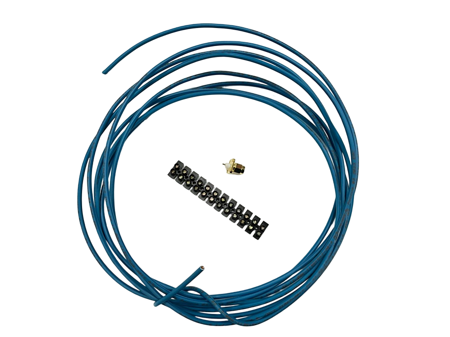

## Нарезаем провода

Нам нужно **5 отрезков провода**: четыре радиала по **18,4 см** и один штырь длиной **14,7 см**. Аккуратно отмерьте каждый отрезок линейкой, сделайте карандашом отметку и откусите провод плоскорезом.

Затем с **одного конца** каждого отрезка снимите изоляцию на **1 см**, чтобы показалась медная жила.

:::note

Указанные длины включают и оголённый участок жилы длиной 1 см. От точности длины зависит, на какой частоте будет работать антенна, поэтому внимательно проверьте отрезки линейкой.

:::

:::warning

При откусывании провода плоскорезом его кусочки могут отлетать, а срез жилы бывает острым. Будьте аккуратны и берегите глаза и пальцы.

:::

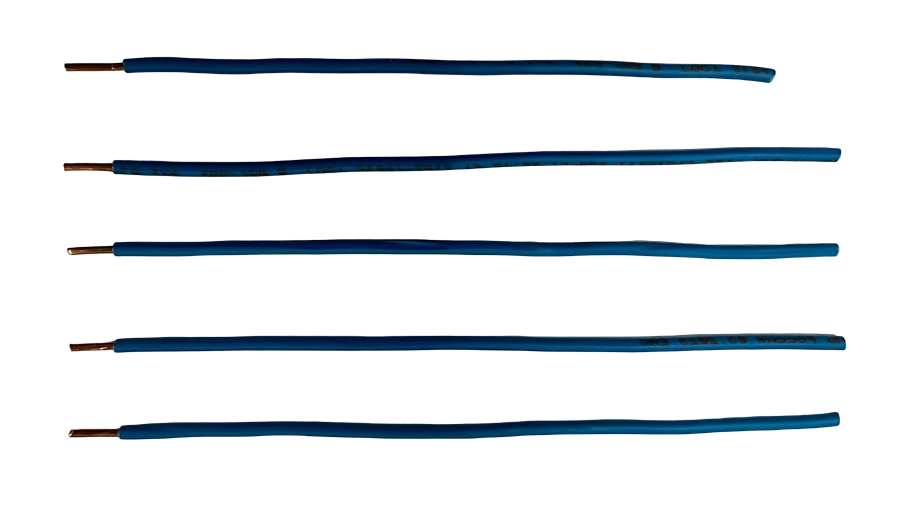

## Делаем шаблон 45°

Радиалы должны отходить от антенны под углом 45°. Чтобы точно выдержать этот угол, сделаем простой шаблон: сложите лист бумаги по диагонали так, чтобы угол листа лёг на противоположную сторону. Получившийся наклонный край и будет нашим углом в 45°.

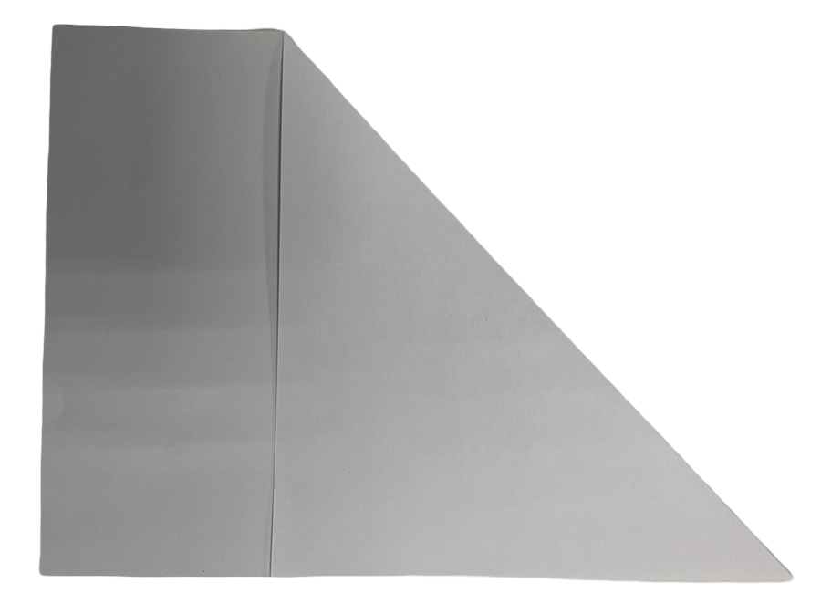

## Загибаем жилу радиалов

Возьмите один из четырёх радиалов (**18,4 см**). Приложите провод к наклонному краю шаблона так, чтобы оголённая жила выступала за угол листа.

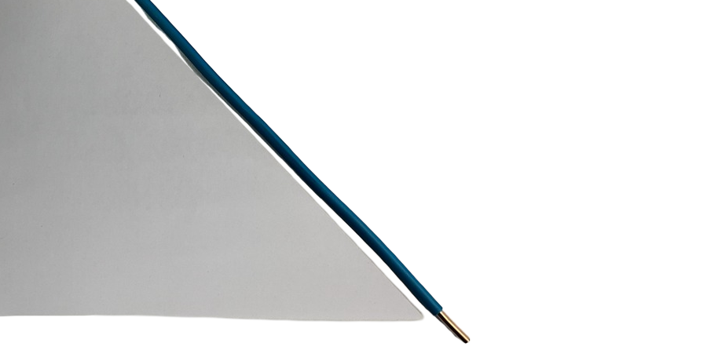

Зажмите жилу плоскогубцами у самого края изоляции и отогните её так, чтобы она легла вдоль нижнего края шаблона.

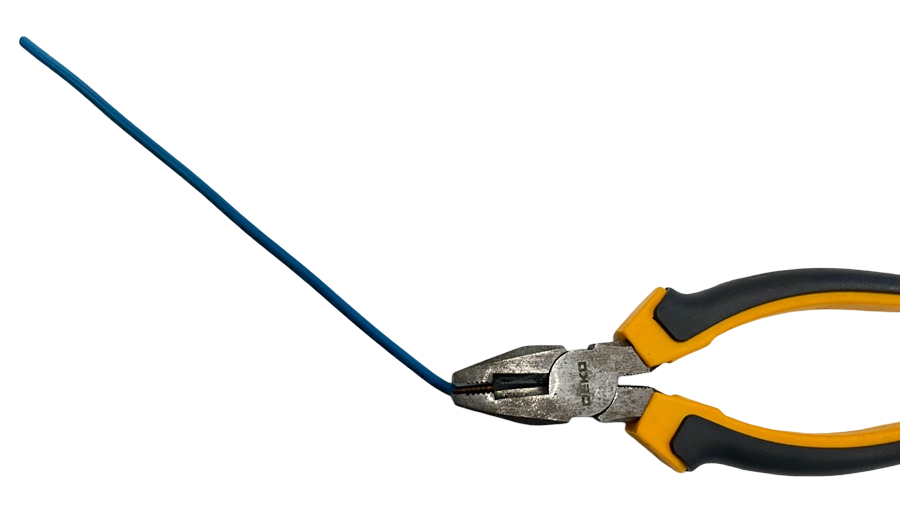

Жила должна отклониться на **45° от продолжения провода** (то есть угол между изолированным проводом и жилой составит 135°). Сравните результат с шаблоном.

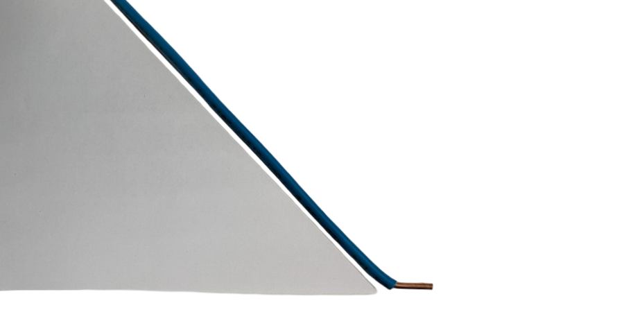

Повторите то же самое для остальных трёх радиалов. **Штырь (14,7 см) остаётся прямым** - его мы не загибаем.

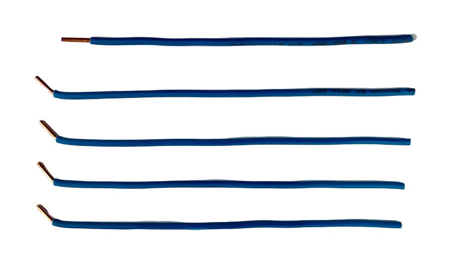

## Подготавливаем клеммы

Клеммы станут «соединителями» между проводами и разъёмом. Разделите клеммную колодку на **5 отдельных секций** с использованием плоскореза.

Каждая секция состоит из пластикового корпуса, латунной гильзы и двух винтов. Нам понадобятся только латунные гильзы и винты. Выкрутите винты, достаньте гильзу из корпуса, а пластиковый корпус отложите - он нам не потребуется. Проделайте это со всеми пятью секциями.

## Закрепляем провода в гильзах

Вставьте оголённую жилу в гильзу и затяните винт отвёрткой, чтобы он надёжно прижал жилу. Второй винт понадобится нам на следующем шаге для крепления гильзы к разъёму.

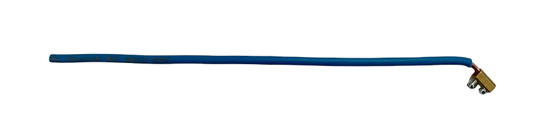

Проделайте то же самое со всеми пятью проводами: четыре радиала с загнутой жилой и один прямой штырь.

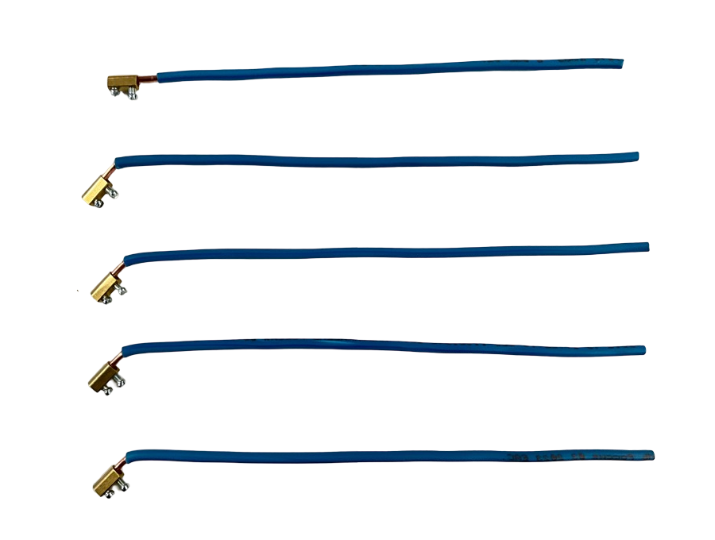

## Крепим радиалы к разъёму

Теперь соберём основание антенны на **SMA-разъёме**. Совместите отверстие гильзы первого радиала с отверстием во фланце разъёма и закрепите гильзу вторым винтом. Радиал должен отходить от разъёма наружу, а загнутая жила - смотреть в сторону от центрального контакта.

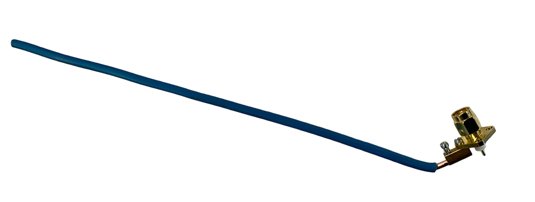

Закрепите второй радиал в **противоположном** отверстии фланца.

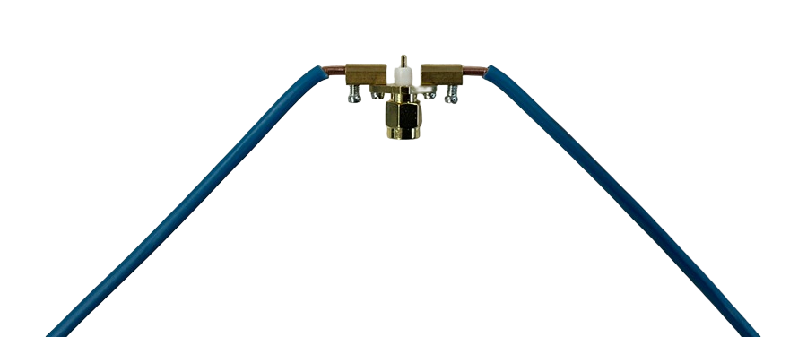

Таким же образом закрепите оставшиеся два радиала в двух свободных отверстиях. В итоге радиалы должны расходиться от разъёма **крестом**.

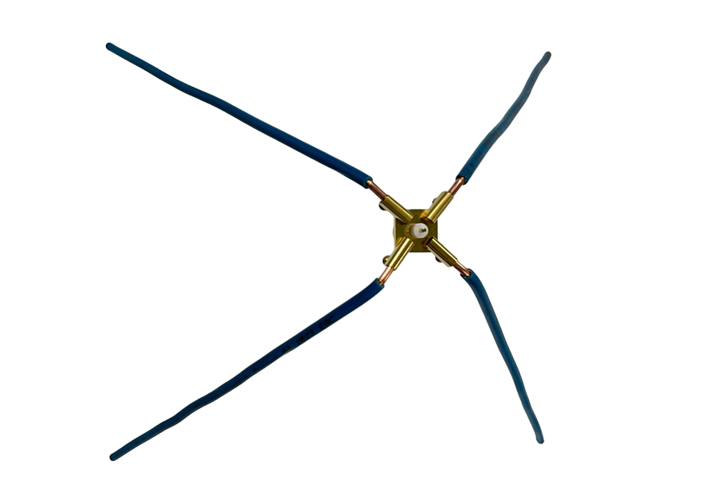

## Устанавливаем штырь

Последний провод - вертикальный **штырь** (**14,7 см**). Наденьте его гильзу на центральный контакт SMA-разъёма и затяните винт отвёрткой.

Антенна готова! Если посмотреть на неё сбоку, штырь направлен вертикально вверх, а радиалы отходят от основания вниз.

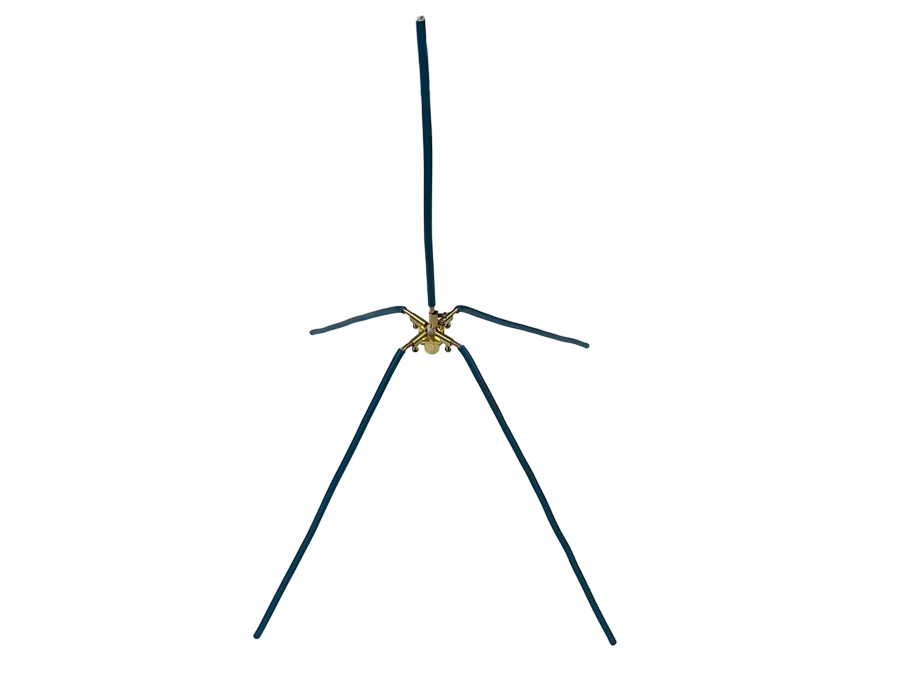

## Подключаем к плате

После сборки антенну можно подключить к плате, собранной в разделе [«Сборка набора»](/docs/kit-assembly).

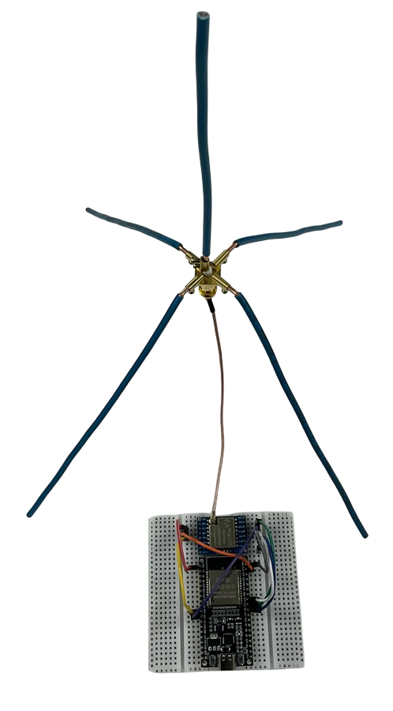

## Что дальше?

Теперь у нас есть всё необходимое, чтобы использовать устройство по назначению:

- [Станция приёма сигналов с космических аппаратов](/docs/station/station-about)
- [Космический аппарат формата cubesat](/docs/cubesat/cubesat-about)
