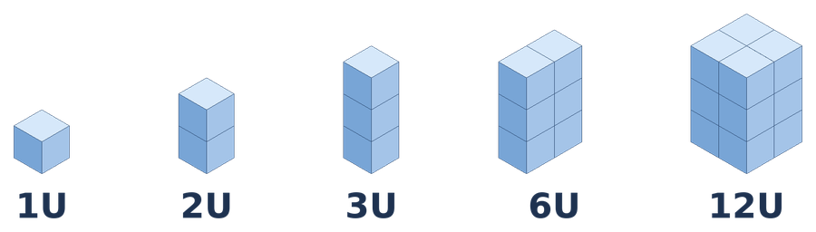

# О кубсате

## Формат cubesat

Космические аппараты бывают очень разными: от огромной Международной космической станции до спутников размером 10 × 10 × 10 см. Чем крупнее спутник, тем дороже и дольше его создавать и запускать, поэтому долгое время космос оставался недоступным для университетов и школ.

Ситуацию изменили **кубсаты**. Название происходит от английского cubesat (cube – «куб», satellite – «спутник»). Это класс малых спутников, которые строят по единому стандарту: размер и форма заданы заранее. Базовая единица стандарта – «юнит» (**1U**): куб со стороной 10 см и массой до 2 кг. Из таких кубиков, как из конструктора, получаются спутники побольше: 2U, 3U, 6U и 12U.

Снаружи кубсат выглядит как небольшая металлическая коробка. По четырем ребрам проходят гладкие направляющие – рельсы. Они нужны для запуска: кубсат помещают в специальный контейнер и перед отделением от ракеты выталкивают пружиной, а он скользит по рельсам контейнера, как поезд по путям.

## Как появился стандарт

Всё началось в 1999 году. Профессор Калифорнийского политехнического университета Джорди Пуиг-Суари и профессор Стэнфордского университета Боб Твиггс хотели, чтобы студенты могли сами проектировать, строить и запускать спутники. Для этого нужно было снизить стоимость и время разработки, сделать космос доступнее и запускать спутники чаще.

Главная идея – единый стандарт. Если все спутники имеют одинаковые размеры, их можно запускать вместе, в одном стандартном контейнере, не придумывая новое крепление под каждый аппарат.

Первые кубсаты полетели **30 июня 2003 года**: ракета «Рокот» стартовала с космодрома Плесецк в России и вывела на орбиту сразу шесть кубсатов университетов и компаний Японии, Канады, Дании и США.

Сначала кубсаты строили в основном университеты. Потом ими заинтересовались компании и космические агентства. В 2018 году к Марсу отправились два кубсата формата 6U (миссия MarCO) вместе с посадочным модулем InSight. А к моменту написания этого руководства, по данным базы [Nanosats Database](https://www.nanosats.eu/), в мире запущено уже более 3000 кубсатов.

## Спецификация формата

Стандарт описан в открытом документе CubeSat Design Specification (CDS), то есть «Спецификации конструкции кубсата». Его поддерживает Калифорнийский политехнический университет, а самую свежую версию можно найти на сайте [cubesat.org](https://www.cubesat.org/).

На момент написания руководства действует версия Rev. 14.1 (февраль 2022 года). Скачать документ можно по ссылке: [CubeSat Design Specification Rev. 14.1 (PDF)](https://www.nasa.gov/wp-content/uploads/2018/01/cubesatdesignspecificationrev14_12022-02-09.pdf).

В спецификации описаны размеры, допустимая масса, материалы, требования к электронике и испытаниям, а также виды контейнеров для запуска.

Основные форматы выглядят так:

| Формат | Размеры, мм | Максимальная масса |
| --- | --- | --- |
| 1U | 100 × 100 × 113,5 | 2 кг |
| 2U | 100 × 100 × 227 | 4 кг |
| 3U | 100 × 100 × 340,5 | 6 кг |
| 6U | два блока по 3U | 12 кг |
| 12U | четыре блока по 3U | 24 кг |

Среди требований есть и такие, которые касаются безопасности. Например, пока кубсат находится в контейнере, вся его электроника должна быть выключена. А после отделения от ракеты он обязан молчать: передатчик можно включить не раньше, чем через 45 минут. Поэтому приемная станция не услышит кубсат сразу после запуска.

:::note

Максимальная масса в таблице указана для типового контейнера. Для конкретного запуска ограничения могут отличаться, их уточняют у компании, которая выводит кубсат на орбиту.

:::

## Атмосферный зонд

В нашем проекте мы будем создавать аппарат формата cubesat, имеющий все необходимые элементы, присущие космическим аппаратам. Единственное отличие будет в том, что мы отправим наш аппарат не в космос, а в высокие слои атмосферы. То есть правильнее будет называть наш аппарат «атмосферным зондом». Но для упрощения мы будем называть создаваемый аппарат, в соответствии с его форматом, просто «кубсат».

Условия на высоте, на которую мы отправим кубсат, будут почти космические (разреженный воздух, высокая радиация, низкое давление). Поэтому высокие слои атмосферы часто называют «ближний космос». Для сравнения: условная граница космоса проходит на высоте 100 км от уровня земли, атмосферные зонды могут достигать высоты 30 км и выше.

## Из чего состоит

Наш кубсат будет включать следующие элементы:

- **Корпус** – в точном соответствии со спецификацией космических аппаратов CubeSat 1U;
- **Электроника** – будем использовать всё то же устройство на базе макетной платы, микроконтроллера ESP32 и радиомодуля Ra-02;
- **Система автономного питания** – установим и подключим блок батареек;
- **Прошивка кубсата** – запрограммируем кубсат, чтобы он передавал на землю служебную информацию и данные с полезной нагрузки.

Кроме того, чтобы принимать сигналы с нашего кубсата во время его полета, нам потребуется еще одно «наземное» устройство и антенна к нему. Также запишем на него необходимую прошивку.

В следующих пунктах разберем всё это более подробно.
