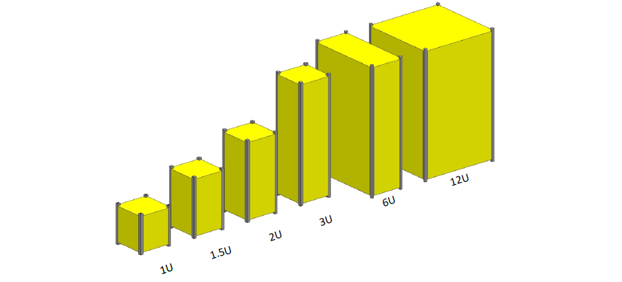

## Формат cubesat

О кубсатах вообще, спецификация формата, как выглядит, картинка. 

  
Lorem ipsum dolor sit amet, consectetur adipiscing elit, sed do eiusmod tempor incididunt ut labore et dolore magna aliqua. Ut enim ad minim veniam, quis nostrud exercitation ullamco laboris nisi ut aliquip ex ea commodo consequat. Duis aute irure dolor in reprehenderit in voluptate velit esse cillum dolore eu fugiat nulla pariatur. Excepteur sint occaecat cupidatat non proident, sunt in culpa qui officia deserunt mollit anim id est laborum.

## Атмосферный зонд

В нашем проекте мы будем создавать аппарат формата cubesat, имеющий все необходимые элементы, присущие космическим аппаратам. Единственное отличие будет в том, что мы отправим наш аппарат не космос, а в высокие слои атмосферы. То есть правильнее будет называть наш аппарат "атмосферным зондом". Но для упрощения мы будем называть создаваемый аппарат, в соотвествии с его форматом, просто "кубсат".  

Условия на высоте, на которую мы отправим кубсат, будут почти космические (разреженный воздух, высокая радиация, низкое давление). Поэтому высокие слои атмосферы часто называют "ближний космос". Для сравнения: условная границы космоса проходит на высоте 100 км от уровня земли, атмосферные зонды могут достигать высоты 30 км и выше. 

## Из чего состоит

Наш кубсат будет включать следующие элементы:  
- Корпус - в точном соответствии со спецификацией космических аппаратов cubesat 1u.
- Электроника - будем использовать всё то же устройство на базе макетной платы, микроконтроллера esp32 и радиомодуля ra-02.
- Система автономного питания - установим и подключим блок батареек.
- Прошивка кубсата - запрограммируем кубсат, чтобы он передавал на землю служебную информацию и данные с полезной нагрузки.  

Кроме того, чтобы принимать сигналы с нашего кубсата во время его полета нам потребуется еще одно "наземное" устройство и антенна к нему. Также запишем на него необходимую прошивку. 

В следующих пунктах разберем всё это более подробно.  