## Служебные модули

Роль служебных модулей, предназначенных для обработки и передачи данных будет выполнять устройство, руководство по сборке которого размещено в первых разделах портала (см. [Сборка набора](../kit-assembly.md)). Роль бортовой вычислительной машины (БВМ) будет выполнять микроконтролле ESP32, а роль системы связи возьмет на себя радиомодуль RA-02.

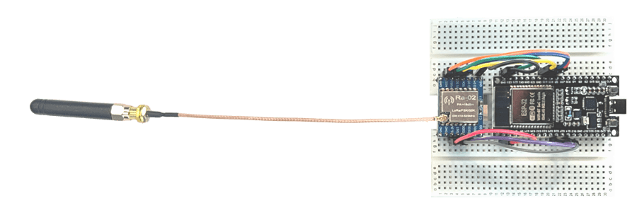

Устройство интегрируется в корпус кубсата. Монтируем его к нижней крестовой панели, закрепляем двумя самореазми по углам макетной платы про дианогонали.

[ВЫДЕЛИТЬ САМОРЕЗЫ]

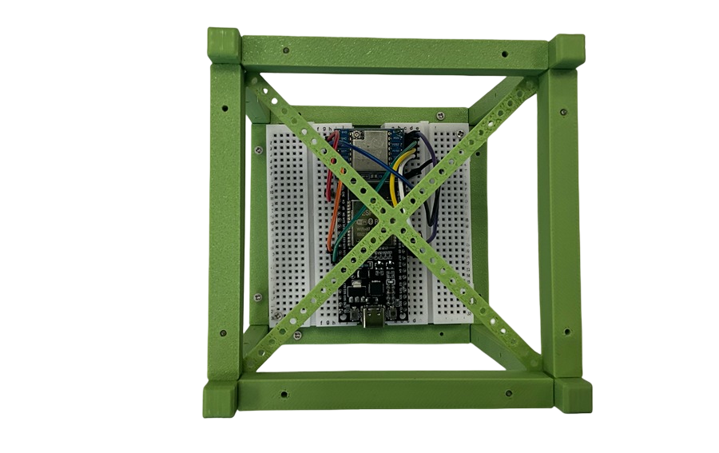

Саморезы, вкручиваемые в отверстия макетной платы как раз должны совпасть с отверстиями панели.

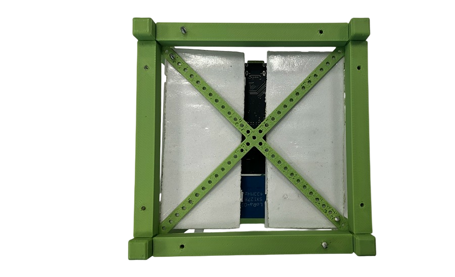

Антенну удобно разместить на одной из граней. При необходимости зафиксировать стяжкой. Проверить, чтобы не выпала из разъема.

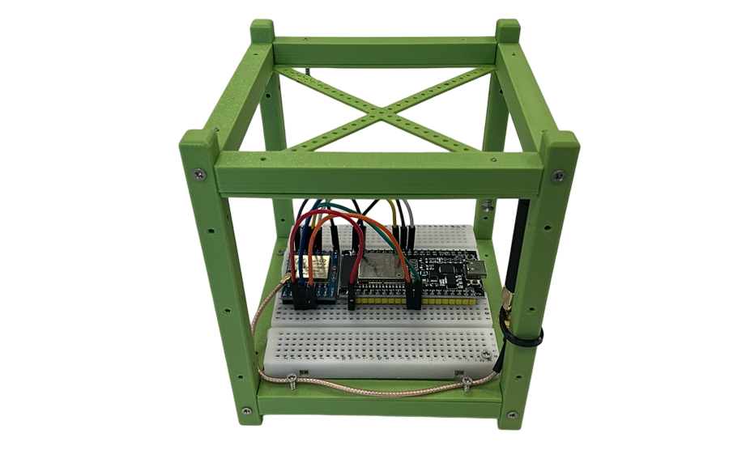

## Система питания

Система питания представлена блоком, вмещающим 3 батарейки АА. Объяснить почему 3, а не другое количество. 4.5 В и т.д. Дорогие аккуляторы нет смысла, т.к. аппарат не возвращается.

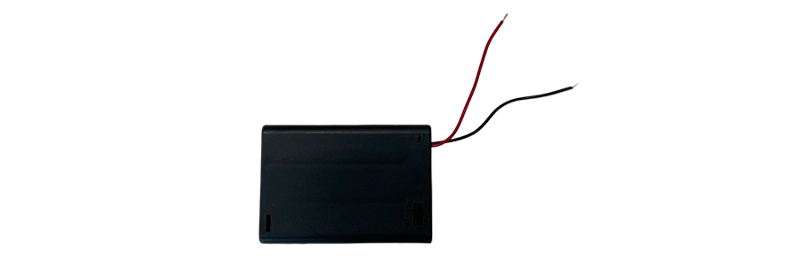

Фото блока с другой стороны, открыта крышка без батареек. Крышка открыта, с батареками (написать, что продается без батареек).

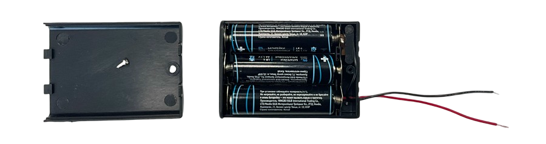

Блок представляет собой контейнер для 3 батареек АА, переключатей Он-Оф. Как правило два провода, без дюбонов на концах.
Чтобы сделать коннекторы к макетной плате, возьмем два дюбон-провода (папа-папа) и отрежем коннекторы от кажого из них только с одной стороны.

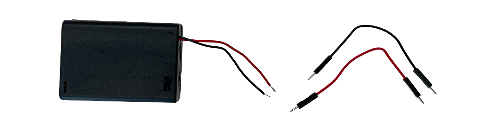

Затем аккуратно снимем оплетку примерно на 1,5 см с концов проводов блока питания и свобоных проводов Дюпон. Для этого удобно использовать канцелярский нож. При этом постарайтесь не повредить внутренние провода. Затем скрутите между собой жилы каждого из концов.

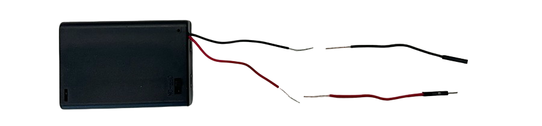

Затем скрутите черные и красные провода друг с другом.

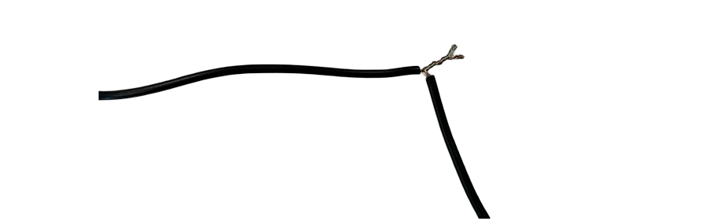

При возможности, обмотайте места соединения изолентой. В итоге у вас получится блок питания с коннекторами дюпон, который можно подсоединить к макетной плате!

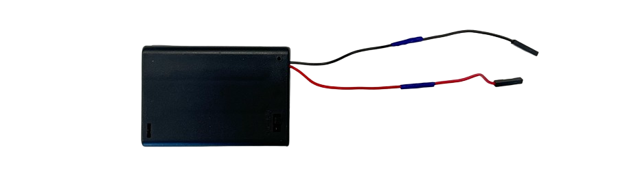

У блока питания уже есть одной отверстие, подходящее для вкручивания используемого нами самореза М2, нам нужно закрутить второй саморез диагонально от имеющегося отверстиями примерно по 5 мм от краев:

[ОТВЕРСТИЯ ДЛЯ САМОРЕЗОВ]

Для размещения системы питания в корпусе удобно выбрать верхнюю панель. Выберите подходящие отверстия в панели и зафиксируйте заморезами ан ней блок питания.

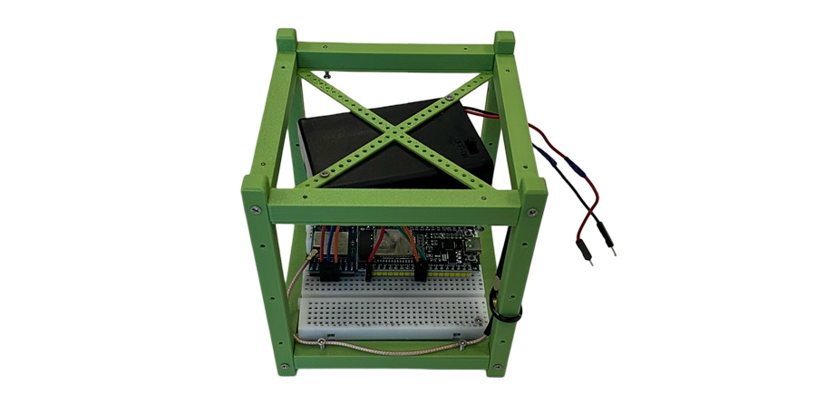

Затем подсоедините питание к макетной плате: красный провод - к пину V5, черный - к пину GND (это будет второй коннектор подключенный к этому пину, подсоединяется рядом.)

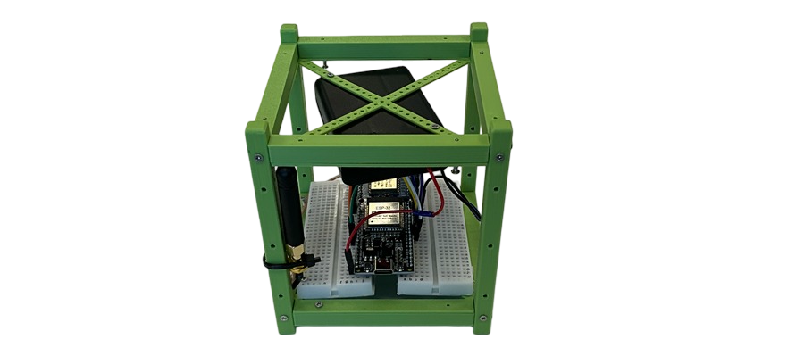

Включите переключатель на блоке питания в положение ON. Если на плате микроконтроллера ESP32 мигает или горит индикатор, значит вы сделали всн правильно. Если индикатор не загорелся, проверьте в первую очередь качество скрученных провождов, правльность подстединения к плате и не разряжены ли батарейки.

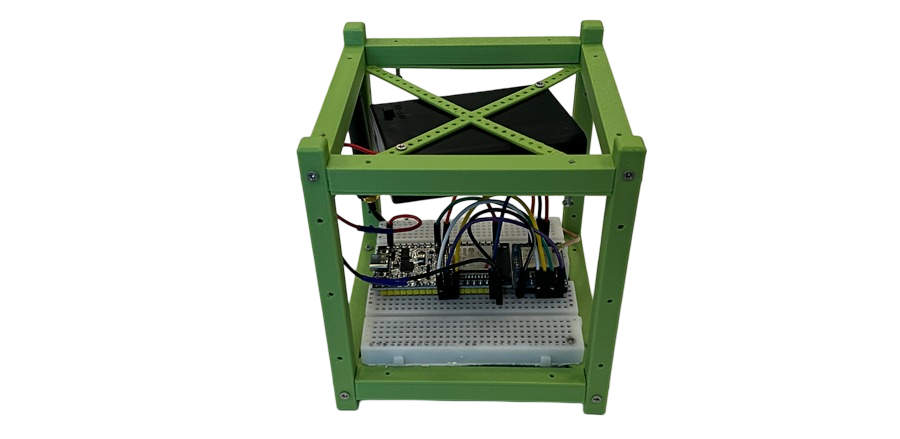

[Потом при запуске залить]

## Полезная нагрузка

Lorem ipsum dolor sit amet, consectetur adipiscing elit, sed do eiusmod tempor incididunt ut labore et dolore magna aliqua. Ut enim ad minim veniam, quis nostrud exercitation ullamco laboris nisi ut aliquip ex ea commodo consequat. Duis aute irure dolor in reprehenderit in voluptate velit esse cillum dolore eu fugiat nulla pariatur. Excepteur sint occaecat cupidatat non proident, sunt in culpa qui officia deserunt mollit anim id est laborum.