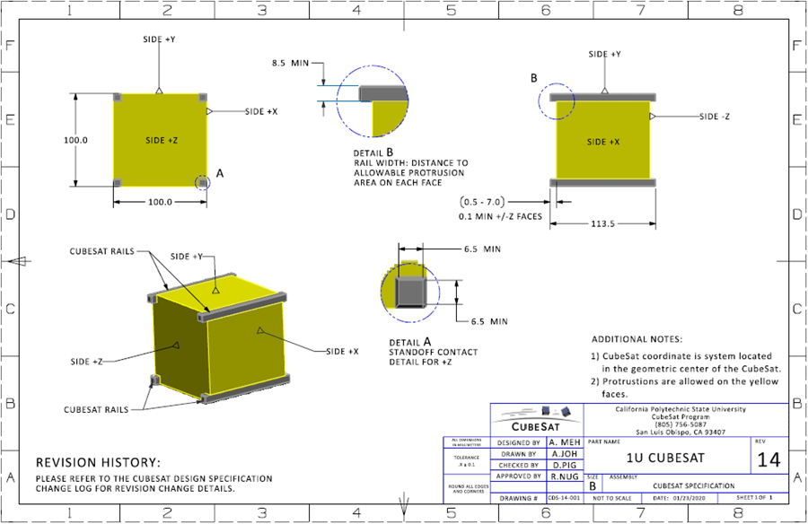
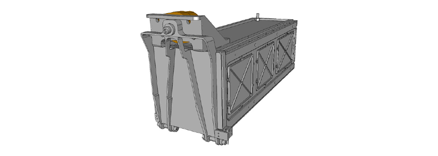
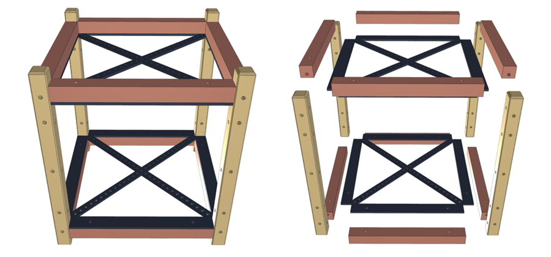
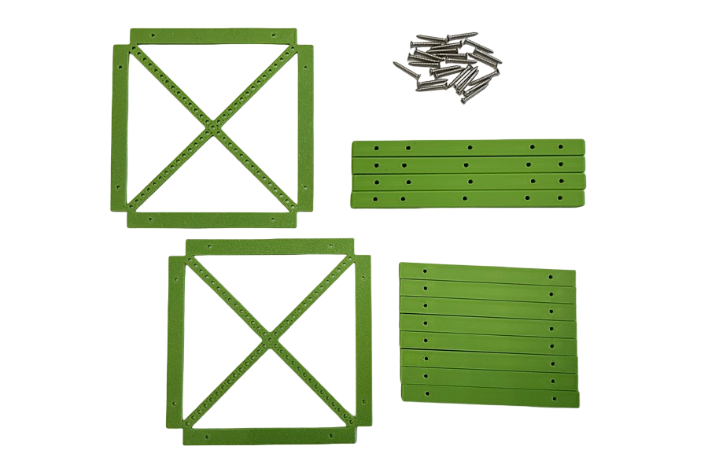
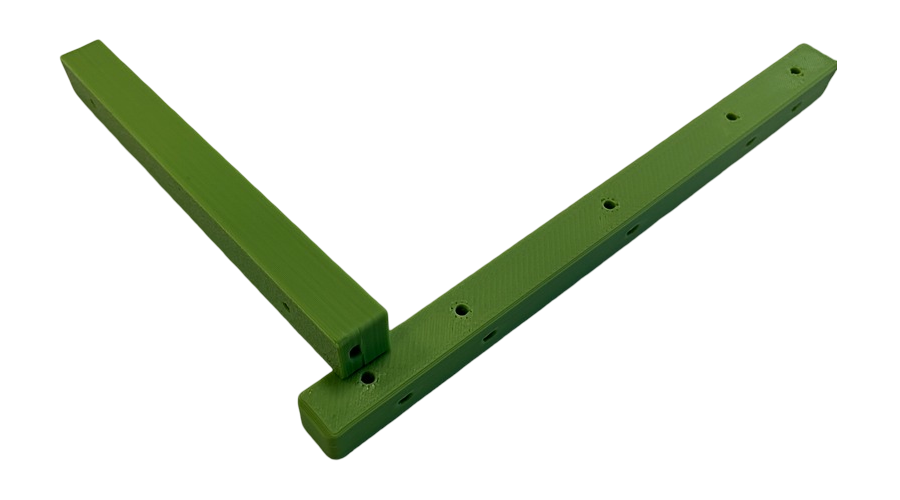
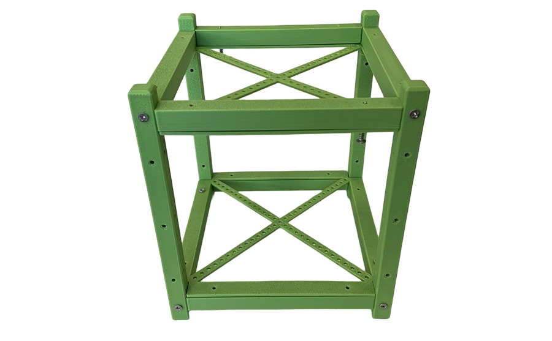

## Спецификация корпуса

Ранее во введении рассказывалось о том, что формат "cubesat" имеет множество разновидностей в зависимости от того, сколько юнитов (кубиков) входит в его состав. В нашей проекте мы будем проектировать раму для cubesat 1u.  

Для формата cubesat 1u существует спецификация со строго определенными размерами:  

Сам "кубик" имеет размер всех граней по 100 мм (10 см), однако боковые "рельсы" выступают за границы куба и составляют в длину 113.5 мм.

Такой формат применятся ввиду того, что перед запуском все кубсаты интегрируются в пусковые контейнеры:

В нашем проекте не будет пускового контейнера, однако мы будем строго придерживаться принятых размеров космических аппаратов.

## 3D-модель корпуса

В соответствии с требованиями спецификации, была спроектирована 3D-модель корпуса кубсата. При необходимости, модель может быть отредактирована в любой CAD-системе (добавлены отверстия для крепления, дополнительные блоки и др.) и затем распечатана на 3D-принтере.  

Интерактиную версию 3D-модели можно посмотреть по данной ссылке: [3D-модель](images/cubesat-frame-3dmodel.html)

Все исходные файлы 3D-модели корпуса приведены ниже:
| Файл модели | Комментарии |
| --- | --- |
| [cubesat_standart.stl](images/cubesat_standart.stl) | Модель, готовая для печати на 3D-принтере |
| [cubesat_standart.step](images/cubesat_standart.step) | Модель для редактирования в CAD-системе |
| [cubesat_standart.scad](images/cubesat_standart.scad) | Модель для редактирования в OpenSCAD |

Облегченная рама

Часто, для того, чтобы разместить внутри кубсата полезную нагрузку и не потерять в подъемной силе, есть необходимость снизить вес корпуса. Для этого предлагаются следующие варианты облегченного корпуса для кубсата:

| Файл модели | Комментарии |
| --- | --- |
| cubesat_light.stl | Модель, готовая для печати на 3D-принтере |
| [cubesat_light.step](images/cubesat_light.step) | Модель для редактирования в CAD-системе |
| cubesat_light.scad | Модель для редактирования в OpenSCAD |

Использование данной модели позволяет снизит общую массу кубсата на 30 г

## 3D-печать элементов

Печать 3D-модели корпуса можно осуществлять без поддержек. Для снижения массы, рекомендуемое заполнение пластиком - 10%.
После печати элементы модели выглядят следующим образоом. Для сборки вам также потребуются саморезы M2-12mm, 28 шт.

## Сборка корпуса

При сборке корпуса в первую очередь боковые балки крепятся к длинным рейкам. При этом нужно внимательно учитывать взаимное расположение отверстий на балкаих рейках.

После соединения балок и реек рамы получаем следующий результат:

**[ФОТО ТОЛЬКО РЕЙКИ И БАЛКИ]**

Затем останется только закрепить панели на имеющуюся раму. Копус кубсата готов!

