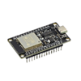
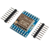
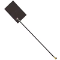
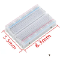
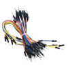

**Наша миссия** - сделать космические технологии доступными для всех.

**Идея** состоит в том, чтобы предложить доступный набор электроники, с помощью которого можно проводить настоящие космические эксперименты.

## Ценности проекта:
- **Универсальность:** возможность проведения различных космических экспериментов: от приема сигналов со спутников до разработки и испытания собственного космического аппарата.
- **Низкая стоимость:** возможность покупки базового набора всеми желающими.
- **Доступность:** применение простых способов соединения частей, сборки и настройки, не требующих специальных знаний.
- **Открытость:** все инструкции доступны на сайте, все детали можно найти и купить самостоятельно.

## Вы сможете

Просто и недорого создать: 
- **собственную наземную станцию** и принять данные со спутников
- **космический аппарат формата cubesat** и запустить его в "ближний космос"
- **радио-мессенджер** и общаться с друзьями без использования интернета

Все необходимые компоненты вы можете купить у нас или заказать самостоятельно.

## Что включает базовый набор?

|    | микроконтроллер esp32         |     |
| ----------------------------------- | ----------------------------- | --- |
|     | **радиомодуль ra-02**         |     |
|  | **антенна**                   |     |
|    | **баспаечная макетная плата** |     |
|    | **соединительные провода**    |     |
## Приемная станция

==Фото приемной станции==

## Космический аппарат

==Фото кубсата==

## Радио-мессенджер

Скоро здесь тоже будет фото.
