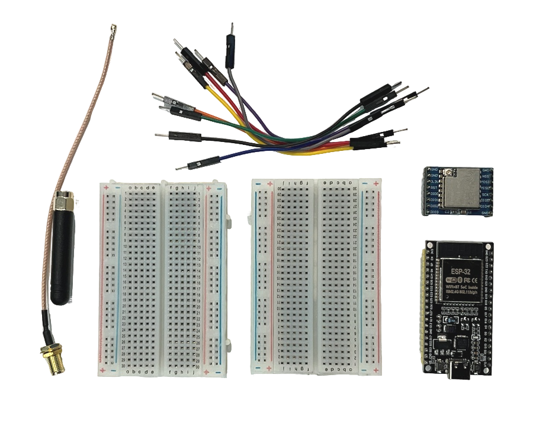
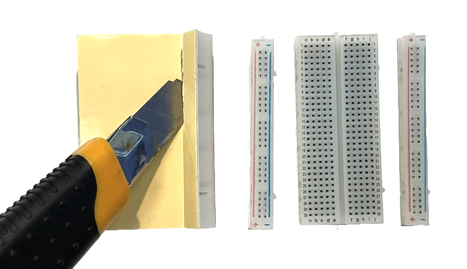
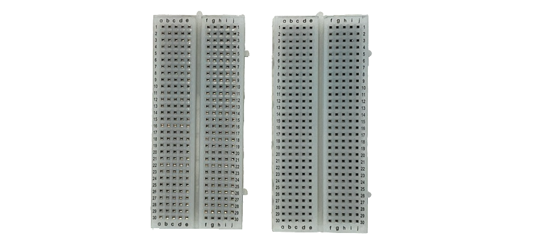
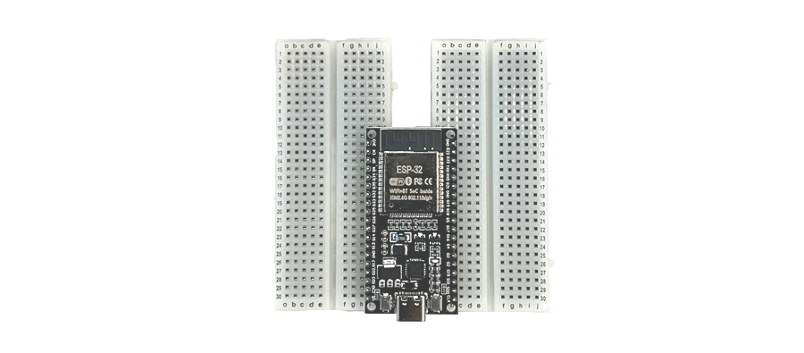
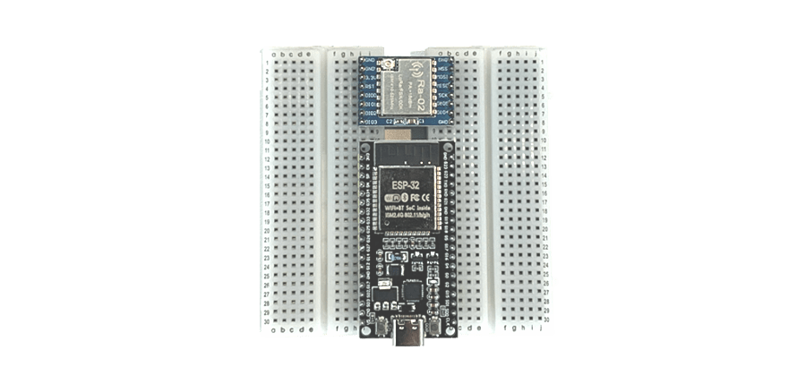
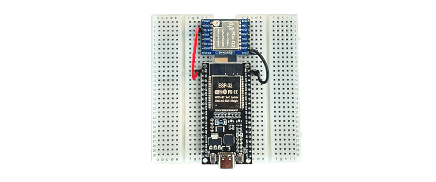
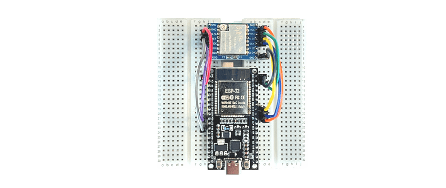
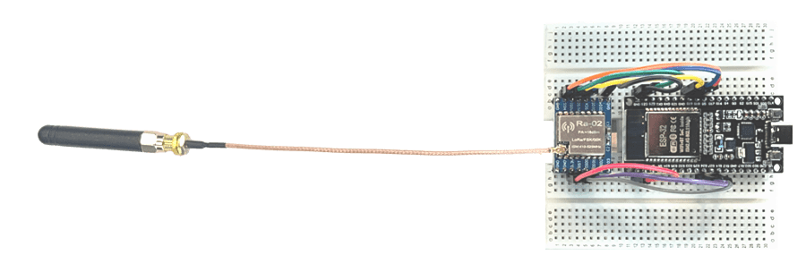
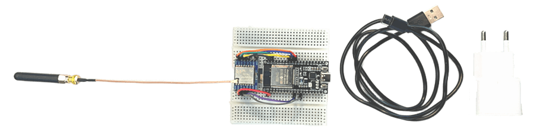

Основу набора космического инженера составляет ряд компонентов, из которого мы соберем устройство. Данное устройство в дальнейшем станет основой для одного из проектов: приемной станции, космического аппарата или радио-мессенджера.

## Компоненты набора

Для сборки нам потребуются:
- Микроконтроллер ESP-WROOM-32 - 1 шт.
- Радиомодуль LoRa SX1278 Ra-02 - 1 шт.
- Антенна с разъемом IPEX - 1 шт.
- Макетная плата - 2 шт.
- Провода - 8 шт.

## Подготовка макетных плат

Наше устройство будет собрано на **Макетных платах** — специальных пластинах с отверстиями, которые позволяют соединять электронные компоненты без пайки.  
Компоненты **Микроконтроллера** и **Радиомодуля** слишком широки для стандартной макетной платы, поэтому используется соединение двух таких плат. Но сначала платы нужно немного «доработать»: по бокам у них расположены длинные линии питания (полоски с красной и синей разметкой), которые нам будут мешать. Аккуратно отделите их от основной части платы. Для этого проведите канцелярским ножом по месту соединения с обратной стороны - линии питания легко отойдут.

В результате у останутся две центральные части от обоих макетных плат. Расместите их рядом как показано на риснке ниже.

## Устанавливаем микроконтроллер

**Микроконтроллер ESP32** - это «мозг» нашей станции. Он будет управлять радиомодулем и всеми другими датчиками. Установите его посередине, так чтобы один ряд ножек попал на левую плату, а другой - на правую. Разместите микроконтроллер в отверстия, как показана на риснке, и равномерно надавите на плату сверху, пока она плотно не сядет на место. Разъем Type-C должен смотреть наружу - к краю платы, чтобы потом было удобно подключить кабель.  

## Устанавливаем радиомодуль

**Радиомодуль Ra-02** - это «уши» нашей станции. Именно он будет ловить и передавать радиосигналы. Установите модуль на макетные платы над микроконтроллером ESP32, точно так же аккуратно совместив ножки с отверстиями. Разъем для антенны должен быть направлен вверх - от микроконтроллера.

## Подключаем провода питания

Пора соединить наши компоненты проводами. Начнем с питания: чтобы радиомодуль заработал, ему нужно электричество, которое он получит от микроконтроллера.  

Возьмите два провода:
- красным проводом соедините вывод `3.3V` **Радиомодуля** с выводом `3V3` на плате **Микроконтроллера** — по нему потечет питание;  
- черным проводом соедините вывод `GND` **Радиомодуля** с выводом `GND` на **Микроконтроллере** — это «земля», общий провод.  

## Подключаем сигнальные провода

Теперь научим **Микроконтроллер** и **Радиомодуль** «разговаривать» друг с другом. Для этого соедините их сигнальными проводами по таблице ниже.  
**Микроконтроллер** обменивается данными с **Радиомодулем** по интерфейсу SPI - это как язык, на котором микросхемы общаются между собой. Подключите провода по одному, внимательно сверяясь с таблицей.

| Радиомодуль Ra-02 | Микроконтроллер ESP32 |
|---|---|
| `GND` | `GND` |
| `3.3V` | `3V3` |
| `MISO` | `G19` |
| `MOSI` | `G23` |
| `SCK` | `G18` |
| `NSS` | `G5` |
| `DIO0` | `G26` |
| `RST` | `G14` |

## Подключаем антенну

Без антенны наш радиомодуль ничего не услышит. Поэтому возьмите антенну и подключите ее кабель к маленькому круглому разъему **IPEX** на **Радиомодуле**. Аккуратно совместите разъем кабеля с разъемом на плате и надавите пальцем до легкого щелчка.

## Подаем питание

Устройство собрано -  осталось его «оживить»! Подключим кабель Type-C к разъему на плате **Микроконтроллера ESP32**, а другой его конец - к USB-порту компьютера или ноутбука. Если все сделано правильно, на плате мигнет светодиод - значит, устройство получило питание и готово к работе.

## Что дальше?

Мы собрали устройство, на основе которого мы можем построить:  
- [Станцию приема сигналов с космических аппаратов](https://space101.org/docs/station/station-about)
- [Космический аппарат формата cubesat](https://space101.org/docs/cubesat/cubesat-about)
- [Радио-мессенджер для общения без интернета](https://space101.org)

:::note
Чтобы улучшить эффективность устройства, очень рекомендуется собрать также более [продвинутую антенну](https://space101.org/docs/antenna-assembly).
:::