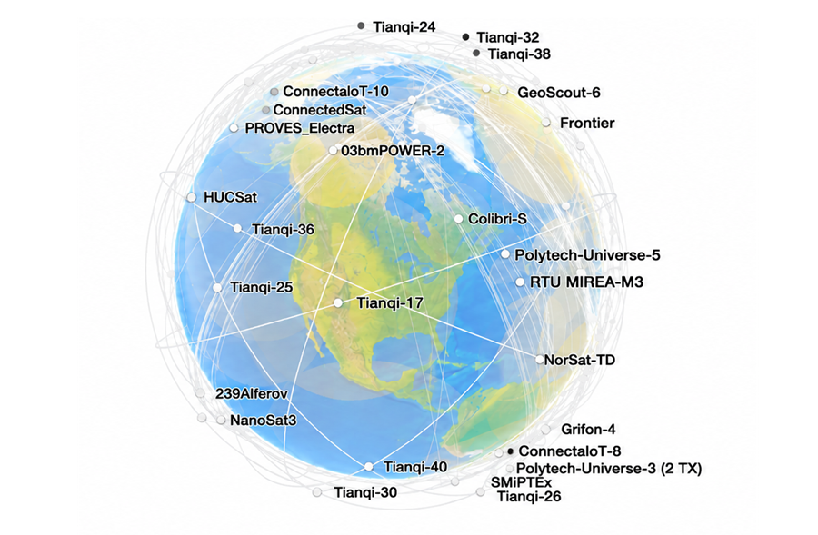
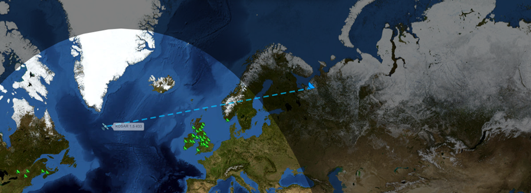
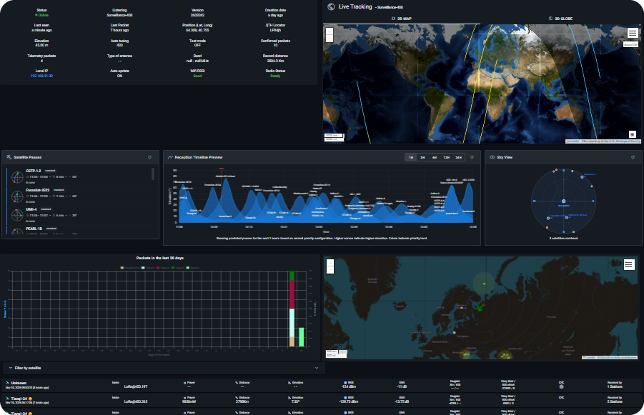

# О приемной станции

В настоящее время на орбите Земли находится большое количество космических аппаратов: по данным [каталога Джонатана Макдауэлла](https://www.planet4589.org/space/stats/active.html), на момент написания данного руководства действующих спутников было более 17 тысяч. Большая часть из них регулярно передает сигналы, содержащие данные о состоянии аппарата или его полезной нагрузки.

Вопреки распространенному мнению, для получения и декодирования таких сигналов не требуются специальные знания или сложные устройства. Сигналы с космических аппаратов можно принимать, даже не выходя из дома!

С использованием набора космического инженера «space101» мы соберем, настроим станцию приема спутниковых сигналов и получим данные с космических аппаратов.

## Зачем нужна приемная станция

Каждым спутником управляет центр управления полетами (ЦУП), а связь с ним обеспечивает наземная станция. Но спутник на низкой орбите облетает Землю примерно за полтора часа и находится в зоне видимости станции ЦУП лишь несколько минут за пролет. Остальное время он остается вне связи, и оператор не знает, что с ним происходит.

А случиться может всякое: сбой бортового компьютера, перезагрузка, перегрев, разряд батареи. Если это происходит, пока спутник вне зоны видимости станции ЦУП, команда не узнает о проблеме до следующего сеанса связи. А чем раньше замечена неисправность, тем больше шансов ее устранить.

Здесь на помощь приходят приемные станции, подобные нашей. Спутник передает свои сигналы открыто, и услышать их может любая станция в зоне видимости, а не только станция ЦУП. Когда одна станция теряет спутник из виду, он уже виден другой, на другом конце страны или даже на другом материке. Принятые данные публикуются в интернете, и оператор может увидеть, как чувствует себя спутник, не дожидаясь собственного сеанса связи.

## Это просто интересно

Но главная причина проще: это интересно! Приемная станция – это ваш личный ЦУП. На панели управления своей станцией вы увидите, какие спутники сейчас пролетают над вами, а на странице каждого принятого сигнала – настоящие данные с борта: напряжение батарей, температуры, токи, перезагрузки. Их передал спутник, который пролетал на высоте сотен километров над вашим домом, а поймала небольшая плата с самодельной антенной.

Станция, которую мы соберем, подключается к **TinyGS** – открытой сети приемных станций, созданной волонтерами. Она появилась в 2019 году, чтобы принять сигналы первого спутника FossaSat-1, а сегодня в ней более 2 тысяч активных станций из более чем 100 стран. Ваша станция станет частью этой сети: принятые ею пакеты увидят и другие участники, и операторы спутников.

## Что дальше?

Плата и антенна уже собраны (см. разделы «[Сборка набора](/docs/kit-assembly)» и «[Сборка антенны](/docs/antenna-assembly)»). Осталось три шага:

- [Прошивка станции](/docs/station/station-firmware) – записываем на плату программу TinyGS;
- [Настройка станции](/docs/station/station-setup) – подключаем станцию к Wi-Fi и к сети TinyGS;
- [Декодирование данных](/docs/station/station-decode) – учимся расшифровывать принятые пакеты.
