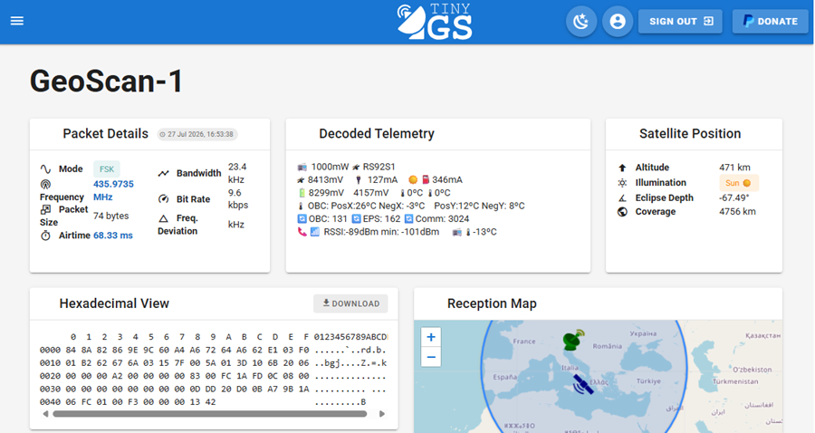
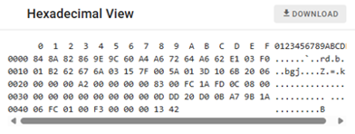
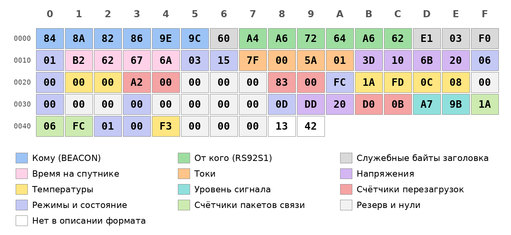

# Декодирование данных

Приёмная станция работает: спутники пролетают над нами, а станция ловит их сигналы и показывает принятые пакеты. Но что такое «пакет» и откуда на странице пакета в **сервисе TinyGS** берутся понятные значения напряжения, тока и температуры?

В этом разделе мы разберём один настоящий пакет и расшифруем его вручную, так же, как это делает программа TinyGS. В качестве примера возьмём пакет со спутника **Геоскан-1** (GeoScan-1), российского спутника компании «Геоскан», запущенного в 2025 году.

## Смотрим на принятый пакет

Откройте страницу любого принятого пакета (как это сделать, мы рассказывали в разделе «[Настройка станции](/docs/station/station-setup)»). Вот как выглядит страница пакета, принятого со спутника Геоскан-1:



На ней несколько блоков:

- **Packet Details** – параметры приёма: режим (FSK), частота (435,9735 МГц), размер пакета (74 байта), время приёма;
- **Hexadecimal View** – сам принятый пакет: 74 числа, записанные в шестнадцатеричной системе;
- **Decoded Telemetry** – готовая расшифровка: напряжения, токи, температуры и другие данные со спутника;
- **Satellite Position** и **Reception Map** – где находился спутник в момент приёма.

Наша задача – понять, как из набора чисел в блоке **Hexadecimal View** получается расшифровка в блоке **Decoded Telemetry**.

:::note

Телеметрия – это данные о состоянии спутника: заряд батареи, температура, работа бортовых систем. Спутник регулярно «докладывает» их на Землю.

:::

## Читаем 16-ричную запись

Всё, что передаёт спутник, – это последовательность **байтов**. Байт – это число от 0 до 255. Чтобы записывать байты коротко, используют шестнадцатеричную (hex) систему: каждый байт записывается двумя «цифрами» от 0 до 9 и от A до F, где A = 10, B = 11, C = 12, D = 13, E = 14, F = 15.

На самом деле спутник передаёт цифровой код: последовательность нулей и единиц, то есть данные в **двоичной системе счисления**. Но записывать их двоичной очень длинно: один байт – это восемь нулей и единиц, например `7F` в двоичной системе выглядит как `01111111`. В шестнадцатеричной системе тот же байт занимает всего два символа. Это самая компактная запись, поэтому её и используют.

<details>
<summary>Таблица соответствия десятичной, шестнадцатеричной и двоичной систем счисления</summary>

| Десятичная | Шестнадцатеричная | Двоичная |
| --- | --- | --- |
| 0 | 0 | 0000 |
| 1 | 1 | 0001 |
| 2 | 2 | 0010 |
| 3 | 3 | 0011 |
| 4 | 4 | 0100 |
| 5 | 5 | 0101 |
| 6 | 6 | 0110 |
| 7 | 7 | 0111 |
| 8 | 8 | 1000 |
| 9 | 9 | 1001 |
| 10 | A | 1010 |
| 11 | B | 1011 |
| 12 | C | 1100 |
| 13 | D | 1101 |
| 14 | E | 1110 |
| 15 | F | 1111 |

</details>

Каждая «цифра» шестнадцатеричной системы – это ровно четыре двоичных разряда, поэтому один байт (восемь разрядов) записывается двумя такими цифрами. Например, `7F`: цифра `7` – это `0111`, цифра `F` – это `1111`, вместе `0111 1111`.

Чтобы перевести байт в обычное число, умножим первую цифру на 16 и прибавим вторую. Например, байт `7F`: 7 × 16 + 15 = **127**.



В блоке Hexadecimal View байты записаны по 16 в строке. Слева стоит номер первого байта строки, записанный в шестнадцатеричной системе (`0000`, `0010`, `0020`...): `0010` – это 16, а `0020` – это 32. Сверху – номер байта внутри строки (`0`...`F`). Справа те же байты показаны в виде символов, а непечатаемые заменены точками.

Положение байта в пакете называют **смещением** (offset): это количество байтов от начала пакета, причём первый байт имеет смещение 0. Например, байт `7F` стоит в строке `0010` (это 16) в столбце `7`, поэтому его смещение – 16 + 7 = **23**. Дальше мы будем указывать смещения в привычной десятичной системе.

:::note

Переводить числа из шестнадцатеричной системы в десятичную удобно с помощью калькулятора Windows: откройте его и переключите в режим «Программист».

:::

## Разбираем пакет на части

Пакет похож на письмо в конверте. В начале (первые 16 байт) находится «конверт»: кому, от кого и какого типа сообщение. Такой формат называется **AX.25**: его придумали радиолюбители, и сегодня он используется на многих спутниках. Дальше идёт само «письмо» – телеметрия. Спутник передаёт пакеты двух видов: **маяк** (он всегда начинается с байтов `84 8A`) и пакеты с данными (например, с координатами и скоростью спутника). Наш пакет – маяк.

На схеме ниже все 74 байта нашего пакета раскрашены по типам данных. Мы расшифруем их по очереди.



## Узнаём получателя и отправителя

Первые 6 байт – адрес получателя, а байты с 7 по 12 – адрес отправителя, то есть позывной спутника. Позывные записываются кодами букв (таблица ASCII), но с хитростью: каждый код умножен на 2. Чтобы получить букву, разделим байт на 2.

<details>
<summary>Фрагмент таблицы ASCII (цифры и заглавные латинские буквы)</summary>

| Символ | Код (hex) | Символ | Код (hex) | Символ | Код (hex) |
| --- | --- | --- | --- | --- | --- |
| 0 | 30 | C | 43 | O | 4F |
| 1 | 31 | D | 44 | P | 50 |
| 2 | 32 | E | 45 | Q | 51 |
| 3 | 33 | F | 46 | R | 52 |
| 4 | 34 | G | 47 | S | 53 |
| 5 | 35 | H | 48 | T | 54 |
| 6 | 36 | I | 49 | U | 55 |
| 7 | 37 | J | 4A | V | 56 |
| 8 | 38 | K | 4B | W | 57 |
| 9 | 39 | L | 4C | X | 58 |
| A | 41 | M | 4D | Y | 59 |
| B | 42 | N | 4E | Z | 5A |

</details>

Получатель (байты 0-5):

| Байт | 84 | 8A | 82 | 86 | 9E | 9C |
| --- | --- | --- | --- | --- | --- | --- |
| Делим на 2 (код буквы) | 42 | 45 | 41 | 43 | 4F | 4E |
| Буква | **B** | **E** | **A** | **C** | **O** | **N** |

Получилось слово **BEACON** – по-английски «маяк». Спутник вещает не кому-то одному, а всем, кто его слышит.

Отправитель (байты 7-12):

| Байт | A4 | A6 | 72 | 64 | A6 | 62 |
| --- | --- | --- | --- | --- | --- | --- |
| Делим на 2 (код буквы) | 52 | 53 | 39 | 32 | 53 | 31 |
| Буква | **R** | **S** | **9** | **2** | **S** | **1** |

Получился позывной **RS92S1** – это позывной спутника Геоскан-1. Он же написан в начале блока Decoded Telemetry.

Почему же код буквы умножен на 2, а не передан как есть? В адресе каждый байт несёт ещё и служебный признак: «адрес продолжается» или «адрес закончился». Для него отведён самый младший бит байта: `0` означает «продолжается», `1` – «закончился». Чтобы освободить место для этого бита, код буквы сдвигают на один бит влево, а это то же самое, что умножить на 2. Поэтому все байты позывного чётные, а последний байт адреса (`E1`) нечётный: единица в конце означает, что адрес закончился.

Остальные байты заголовка нам почти не нужны: `60` и `E1` содержат ещё и дополнительный номер станции (SSID, у спутника он равен 0), `03` – тип кадра, а `F0` – тип протокола верхнего уровня (в нашем случае его нет). Мы их пропустим.

## Узнаём, как хранятся числа

Дальше идёт телеметрия. Большинство значений занимает **два байта** (так можно записать число от 0 до 65535). И тут есть подвох: первым передаётся младший байт, а старший – вторым. Этот порядок называется **little-endian** («маленьким концом вперёд»). Поэтому перед переводом в десятичную систему два байта нужно **поменять местами**: так, как если бы мы сначала назвали единицы, а потом сотни.

Пример. В пакете по смещению `23` стоят байты `7F 00`. Меняем местами: `00 7F`. Переводим: 0 × 256 + 127 = **127**.

Ещё один пример. По смещению `25` стоят байты `5A 01`. Меняем местами: `01 5A`. Переводим: 1 × 256 + 5 × 16 + 10 = 256 + 90 = **346**.

## Узнаём время на спутнике

Сразу после заголовка в пакете идёт номер маяка (один байт, `01`), а за ним – **время на борту спутника**. Оно занимает четыре байта и записано как количество секунд, прошедших с 1 января 1970 года. Такой способ записи времени называется **unix-временем**.

По смещению `17` стоят байты `B2 62 67 6A`. Меняем порядок: `6A 67 62 B2`. Переводим в десятичную систему (удобно сделать это калькулятором) и получаем **1 785 160 370** секунд. Это **27 июля 2026 года, 13:52:50 по UTC**. В блоке Packet Details время приёма показано в часовом поясе вашего компьютера, поэтому оно отличается на несколько часов.

## Расшифровываем токи и напряжения

Проделаем то же самое для токов и напряжений. Для примера подробно разберём байты `3D 10` по смещению `27`: меняем местами – `10 3D`; переводим: 1 × 4096 + 0 × 256 + 3 × 16 + 13 = 4096 + 48 + 13 = **4157**.

Вот результаты для всех значений:

| Смещение | Байты в пакете | Меняем местами | Число | Что это |
| --- | --- | --- | --- | --- |
| `23` | `7F 00` | `00 7F` | 127 | ток потребления, мА |
| `25` | `5A 01` | `01 5A` | 346 | ток солнечных панелей, мА |
| `27` | `3D 10` | `10 3D` | 4157 | напряжение одной батареи, мВ |
| `29` | `6B 20` | `20 6B` | 8299 | напряжение двух батарей, мВ |
| `57` | `DD 20` | `20 DD` | 8413 | напряжение шины модуля связи, мВ |

- **127 мА** – ток, который потребляет спутник, а **346 мА** – ток, который вырабатывают его солнечные панели;
- **4157 мВ** – напряжение одной батареи, а **8299 мВ** (около 8,3 В) – напряжение двух батарей вместе. Проверьте себя: 4157 × 2 = 8314, это близко к 8299;
- **8413 мВ** – напряжение шины питания модуля связи.

:::note

Названия и смысл полей взяты из открытого описания формата пакетов спутников Геоскан.

:::

## Расшифровываем температуры и уровень сигнала

Температура занимает всего **один байт**. Но температура бывает и отрицательной! Как записать -3 одним байтом? Для этого используется простое правило:

- если байт не больше 127 (то есть от `00` до `7F`), то это само число;
- если байт больше 127 (от `80` до `FF`), то число отрицательное, и чтобы его получить, нужно **вычесть 256**.

Например, байт `FD` – это 253, а 253 - 256 = **-3**. Такие числа называют **числами со знаком**, а обычные – числами без знака. Чтобы правильно прочитать байт, нужно знать, к какому виду относится поле.

| Смещение | Байт | Число | Расчёт | Результат | Что измеряет |
| --- | --- | --- | --- | --- | --- |
| `33` | `00` | 0 | нет | 0 °C | ячейка батареи 1 |
| `34` | `00` | 0 | нет | 0 °C | ячейка батареи 2 |
| `43` | `1A` | 26 | нет | 26 °C | панель X+ |
| `44` | `FD` | 253 | 253 - 256 | -3 °C | панель X- |
| `45` | `0C` | 12 | нет | 12 °C | панель Y+ |
| `46` | `08` | 8 | нет | 8 °C | панель Y- |
| `68` | `F3` | 243 | 243 - 256 | -13 °C | плата связи |

Подписи X+, X-, Y+ и Y- обозначают положительную и отрицательную стороны осей X и Y спутника. Температуры панелей разные: на одной +26 °C, на другой -3 °C.

По тому же правилу расшифровывается и уровень радиосигнала **RSSI**. Это сила сигнала, который принимает модуль связи самого спутника (текущая и минимальная). Байт `A7` – это 167, а 167 - 256 = **-89** дБм. Байт `9B` – это 155, а 155 - 256 = **-101** дБм. Чем ближе число к нулю, тем сильнее сигнал.

## Считаем перезагрузки

На спутнике несколько «компьютеров»: бортовой компьютер (**OBC**), система электропитания (**EPS**) и модуль связи (**Comm**). Каждый из них считает, сколько раз он загружался. Эти счётчики занимают по два байта, поэтому снова меняем байты местами.

| Смещение | Байты в пакете | Меняем местами | Число | Что считает |
| --- | --- | --- | --- | --- |
| `40` | `83 00` | `00 83` | 131 | бортовой компьютер |
| `35` | `A2 00` | `00 A2` | 162 | электропитание |
| `59` | `D0 0B` | `0B D0` | 3024 | модуль связи |

Для последнего значения: 0 × 4096 + 11 × 256 + 13 × 16 + 0 = 2816 + 208 = **3024**.

:::note

Перезагрузки в космосе – обычное дело: космическое излучение может вызывать сбои, и тогда электроника перезапускается.

:::

## Читаем режимы и состояние систем

В пакете есть и поля, которых нет в блоке Decoded Telemetry. Их значения тоже можно расшифровать: в описании протокола для них перечислено, какое число что означает.

| Смещение | Байт | Число | Что означает |
| --- | --- | --- | --- |
| `21` | `03` | 3 | режим электропитания: 3 – нормальный (normal) |
| `56` | `0D` | 13 | тип связи: 13 – второй комплект связи (Comm #2) |
| `67` | `00` | 0 | режим связи: 0 – Mode I |
| `51` | `00` | 0 | режим камеры: 0 – ожидание (Waiting) |
| `48` | `00` | 0 | система ориентации: 0 – выключена |
| `63` | `1A` | 26 | принято корректных пакетов: 26 |
| `64` | `06` | 6 | принято некорректных пакетов: 6 |
| `65` | `FC` | 252 | отправлено пакетов: 252 |

Обратите внимание на байт `FC` в последней строке: это число **без знака**, поэтому оно равно 252. А в поле температуры такой же байт `FC` означал бы -4. Поэтому, чтобы правильно прочитать байт, нужно знать тип поля.

Некоторые поля – **битовые**: каждый бит в них отвечает за свою систему спутника. Возьмём поле состояния систем по смещению `31`: два байта `06 00`. Меняем местами: `00 06`, в двоичной записи это `0000 0000 0000 0110`. Биты нумеруют справа налево, начиная с нуля, поэтому единицы стоят на местах 1 и 2. По описанию протокола бит 1 – это COMMu2 (второй комплект связи), а бит 2 – OBC (бортовой компьютер). Обычно единица в таком поле означает «включено». Это согласуется с полем типа связи: связь работает от второго комплекта.

Ещё один пример: поле состояния бортового компьютера по смещению `42`. Байт `FC` в двоичной записи – `1111 1100`. Единицы стоят на местах от 2 до 7: это INS, камера и четыре панели (X+, X-, Y+, Y-).

## Расшифровываем с помощью программы

Тот же расчёт можно поручить компьютеру. Вот короткая программа на языке Python. Её можно запустить на любом компьютере с Python или в онлайн-интерпретаторе.

```python
import datetime

hex_text = """
84 8A 82 86 9E 9C 60 A4 A6 72 64 A6 62 E1 03 F0
01 B2 62 67 6A 03 15 7F 00 5A 01 3D 10 6B 20 06
00 00 00 A2 00 00 00 00 83 00 FC 1A FD 0C 08 00
00 00 00 00 00 00 00 00 0D DD 20 D0 0B A7 9B 1A
06 FC 01 00 F3 00 00 00 13 42
"""
data = bytes.fromhex(hex_text)

def u16(offset):  # два байта, младший первым
    return int.from_bytes(data[offset:offset + 2], "little")

def u32(offset):  # четыре байта, младший первым
    return int.from_bytes(data[offset:offset + 4], "little")

def s8(offset):  # один байт со знаком
    return int.from_bytes(data[offset:offset + 1], "little", signed=True)

print("Позывной:", bytes(b >> 1 for b in data[7:13]).decode())
print("Время (UTC):", datetime.datetime.fromtimestamp(u32(17), datetime.timezone.utc))
print("Режим электропитания:", data[21])
print("Токи, мА:", u16(23), u16(25))
print("Напряжения, мВ:", u16(57), u16(29), u16(27))
print("Температуры батарей, °C:", s8(33), s8(34))
print("Температуры панелей, °C:", s8(43), s8(44), s8(45), s8(46))
print("Системы (биты):", format(u16(31), "016b"))
print("Перезагрузки:", u16(40), u16(35), u16(59))
print("RSSI, дБм:", s8(61), s8(62))
print("Температура платы связи, °C:", s8(68))
```

Запись `b >> 1` означает «разделить на 2» (сдвиг на один бит вправо). Попробуйте изменить пакет и посмотреть, как изменятся результаты.

## Что дальше?

Теперь вы умеете читать данные, которые передают спутники. Попробуйте расшифровать другие пакеты со страницы вашей станции: у других спутников формат отличается, но принципы те же.
