Для того, чтобы наша приемная станция заработала, нужно записать на нее программу (прошивку). Для этого подсоедините устройство к компьютеру (ноутбуку) с помощью кабеля TypeC–USB. Также убедитесь, что доступно подключение к wifi.  

## Установка драйверов

Первым делом необходимо установить драйвера, чтобы компьютер "увидел" наше усройство.
Скачайте архив с драйвером по данной ссылке: [CP210x_Universal_Windows_Driver.zip](../CP210x_Universal_Windows_Driver.zip). Нажмите на него правой кнопкой мыши и выберите пункт `Извлечь все`.

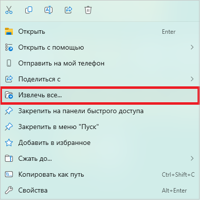

В открывшемся окне выберите папку, в которую будут распакованы файлы, и нажмите кнопку `Извлечь`. 

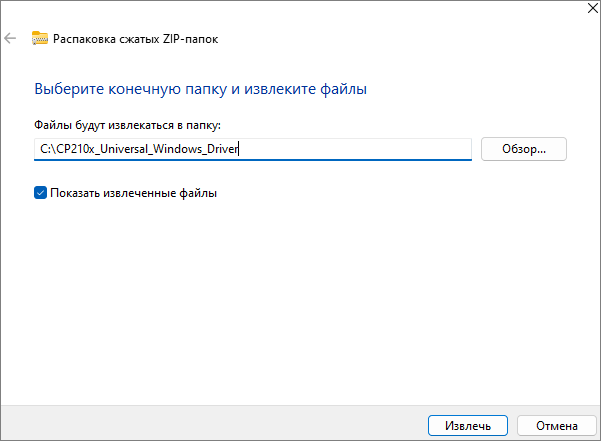

После распаковки откроется папка с файлами драйвера. Найдите в ней установочный файл **silabser.inf**. 

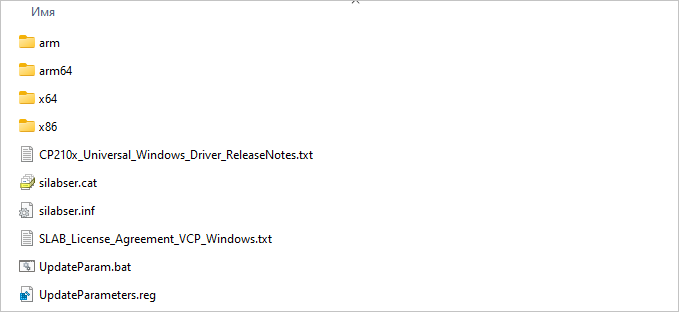

Нажмите на установочный файл правой кнопкой мыши и выберите `Установить`. Дождитесь сообщения об успешной установке драйвера.

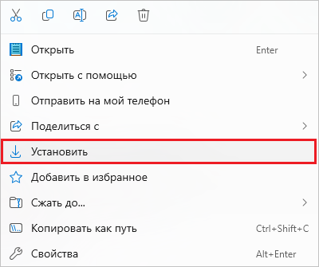

Дождитесь сообщения об успешной установке драйвера.

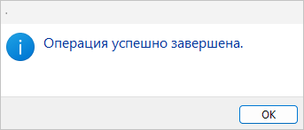

## Установщик TinyGS

Для прошивки нашей приемной станции мы будем использовать популярный сервис **TinyGS**, с помощью которого люди по всему земному шару имеют возможность принимать данные с космических аппаратов.
Зайдите на сайт [https://installer.tinygs.com/](https://installer.tinygs.com/). Подключите устройство кабелем к компьютеру и нажмите кнопку `Install`.

  
Если сайт не загружается

  Сайт tinygs.com не заблокирован в России, однако часто возникают проблемы с его загрузкой.

  Нажмите комбинацию клавиш `Win` + `I`, откроется окно "Параметры". Затем в столбце слева нажмите "Сеть и Интернет" и выберите "Прокси-сервер". Затем нажмите "Использовать прокси-сервер", в открывшемся окне включите ползунок и введитете IP-адрес и порт:  

  `45.93.214.106`  
  `8000`

  В поле "Не использовать прокси-сервер для адресов которые начинаются с указанных ниже записей" введитете

  `192.168.*.*`  

  Поставьте галочку "Не использовать прокси-сервер для локальных (внутрисетвеых) адресов".  
  Нажмите кнопку `Сохранить`.

  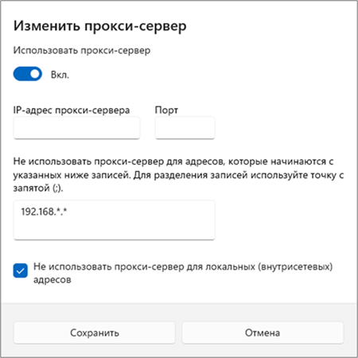

  Теперь в попытке входа на сайт система спросит логин и пароль. Введите следующие:

  Логин: `V6G6AV`  
  Пароль: `vbcoHq`

  Когда завершите работу с сайтом **tinygs.com**, не забудьте в окне "Редактировать настройки прокси" сдвинуть ползунок в положение `Выкл.` и нажать кнопку `Сохранить`.

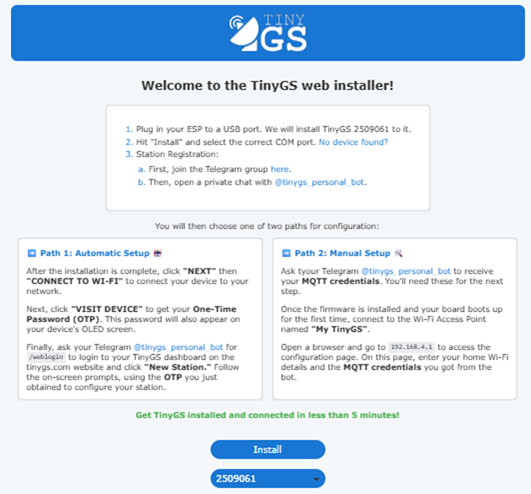

## Подключение к станции

Откроется окно, в котором необходимо разрешить установщику обратиться к нашей станции. В списке устройств выберите наименование устройства, как показано на изображении, и нажмите кнопку `CONNECT`. COM-порт, указанный в скобках, может отличаться.

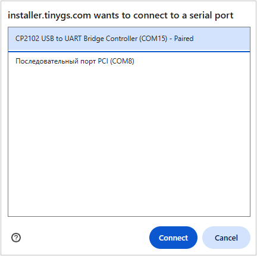

## Начало установки

Для начала установки в появившемся окне нажмите `INSTALL TINYGS`.

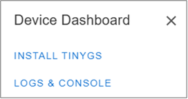

## Удаление старой прошивки

Установщик предложит стереть память устройства перед записью прошивки. Поставьте галочку `Erase device`. Так в станции не останется старых настроек и данных. Для продолжения нажмите `NEXT`.

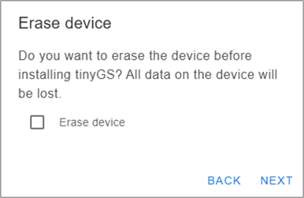

## Подтверждение установки

В появившемся окне подтвердите установку нажав на кнопку `INSTALL`.

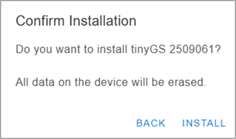

## Процесс установки

Начнется запись прошивки. На экране появится индикатор прогресса. Процесс занимает несколько минут: не закрывайте страницу и не отключайте кабель, пока установка не завершится.

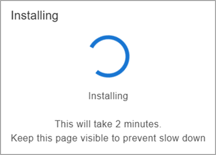  

## Завершение установки

Когда прошивка будет записана, в окне появится надпись **Installation complete!** Это значит, что станция успешно прошита. Нажмите кнопку `Next`.

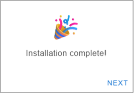  

## Подключение к WiFi

Станции нужен доступ к интернету, чтобы передавать на сервер TinyGS принятые спутниковые данные. Выберите в списке вашу WiFi-сеть, введите пароль и нажмите `Connect`.

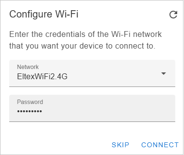  

## Станция прошита

Если подключение выполнено успешно, в окне появится кнопка `VISIT DEVICE`. Станция прошита и подключена к сети - теперь ее необходимо настроить. Именно с этого окна мы начнем следующий шаг.

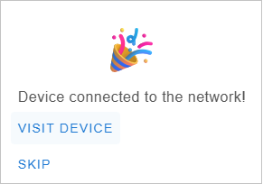  

