После установки прошивки станции, требуется выполнение настройки.   
На предыдущем шаге мы остановились на данном окне. Нажимаем `VISIT DEVICE`.   

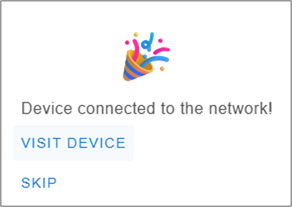

## Страница настроек

После нажатия кнопки `VISIT DEVICE` мы попадаем на страницу настроек нашей приемной станции. Мы обращаемся к ней непосредственно по WiFi, поэтому важно, чтобы и станция, и компьютер, с которого мы работаем, были подключены к одной WiFi-сети. 

## Окно конфигурации (Шаг 1)

Нажимаем `Configure parameters`.  

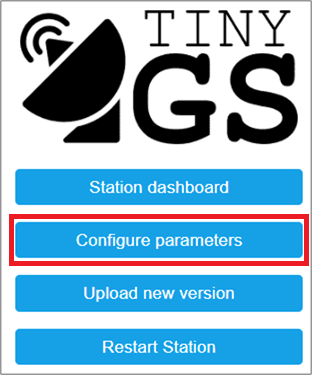

Необходимо заполнить следующие поля:
| Название поля | Что значит |
| ------------- | ------------ |
| **GroundStation Name** | Любое название  |
| **Latitude** | Координаты широты расположения станции (как найти см. ниже) |
| **Longitude** | Координаты долготы расположения станции (как найти см. ниже) |
| **Time Zone** |  Найдите в списке город, по времени которого вы живете  |
| **MQTT Username** | Имя для доступа к серверу данных (как получить см. ниже)  |
| **MQTT Password** | Пароль для доступа к серверу данных (как получить см. ниже) |

<details>
  <summary>Как узнать широту и долготу</summary>
  
  Широту и долготу можно найти, воспользовавшись сервисом Яндекс.Карты https://yandex.ru/maps. Найдите на карте ваше местоположение и в адресной строке браузера будут указаны координты.
  
  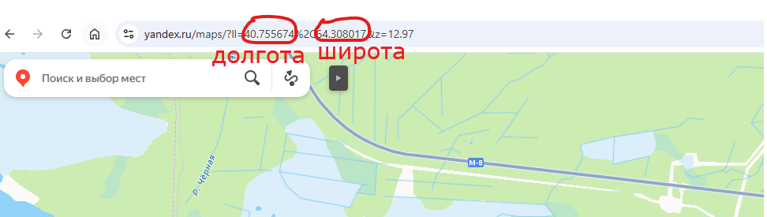
</details>

Данные для заполнения полей **MQTT Username** и **MQTT Password** можно одним из двух способов: через мессенджер Telegram или через электронную почту.

<details>
  <summary>Через мессенджер Telegram</summary>
  
  В поиске **Telegram** найдите группу **tinyGScom** и добавьтесь в неё, затем найдите **tinygs_personal_bot** и откройте диалог. Нажмите кнопку `Menu`, затем выберите `Creates or edits your MQTT account`.  

  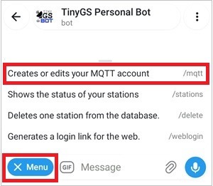  

  Полученное в ответном сообщении значение **User** заполните в поле **MQTT Username**, значение **Pass** – заполните в поле **MQTT Password**.  

  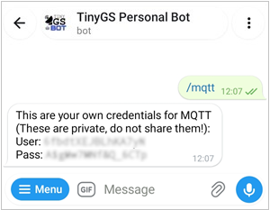  

</details>

<details>
  <summary>Через электронную почту</summary>
  
  Если у вас не работает **Telegram**, то информацию для заполнения полей **MQTT Username** и **MQTT Password** можно получить, запросив invite (приглашение) в проект.  
  Сделать это можно в чате ВК по ссылке: ___  
  либо написав на почту: ___  
  
  Зайдите на свою электронную почту. Когда вам отправят приглашение, вы получите письмо следующего вида. Нажмите кнопку `Accept Invitation and Register`.  

  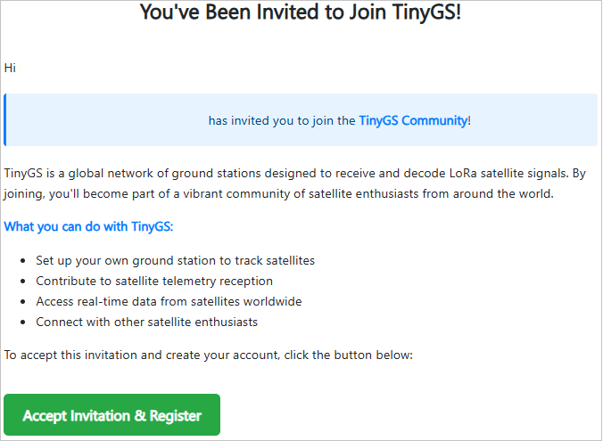 
  
  Вы попадете на сайт **tinygs.com**, где вам необходимо заполнить данные для регистрации: 
  **Enter your email** (адрес электронной почты, на которую вы получили приглашение)
  **Choose a PUBLIC** username (ваше имя, может быть любым)
  Затем нажмите кнопку `REGISTER`.  
  
  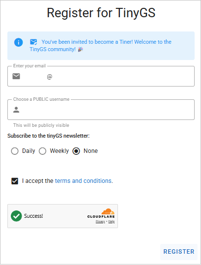  

  Снова загляните в свою электронную почту и получите письмо с подтверждением вашего электронного адреса. Нажмите кнопку `Confirm e-mail`.  

  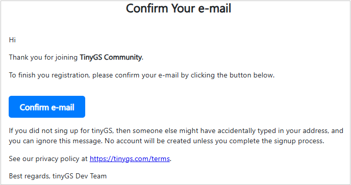  
  
  Вы попадете на сайт **tinygs.com**, где уже будет выполнен вход в ваш аккаунт. Нажмите кнопку с человечком в верхней части страницы.  

  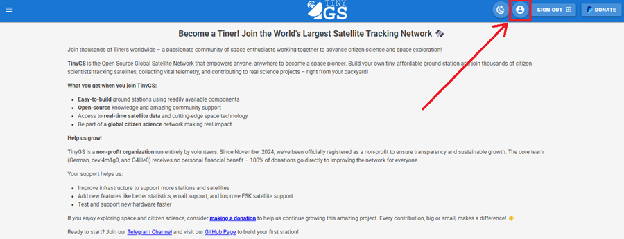  

  На следующей странице нажмите `Setup`.  
  
  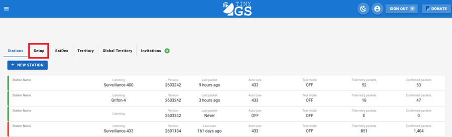  

  Далее, нажмите кнопку `CREDENTIALS`.  

  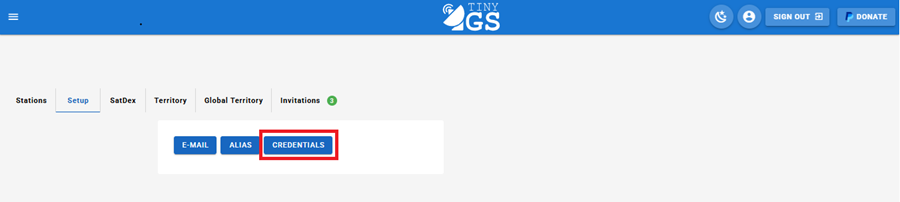  

  И, наконец, вы получите данные для заполнения необхоидмых полей. Для того, чтобы увидеть значение **Password**, нажмите значек с глазом. При необходимости, сохраните или запишите полученные значения.  

  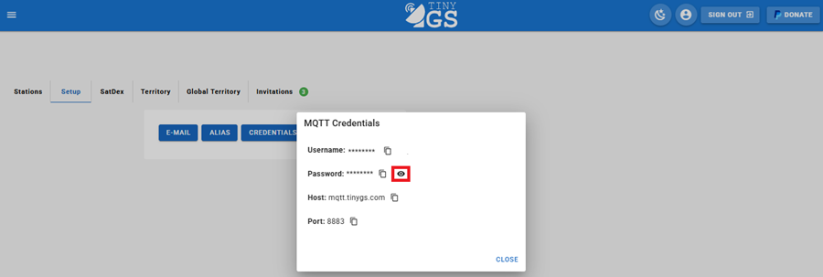  

  Вернитесь к нашей форме и заполните значение **Username** в поле **MQTT Username**, **Password** - в поле **MQTT Password**.  

</details>

## Окно конфигурации (Шаг 2)

Вид форм, заполненных на данном этапе, должен выглядеть приблизительно следующим образом. Обратите внимание, что в заполненных полях у вас должны быть свои значения, не обязательно совпадающие с информацией на изображениях ниже.  

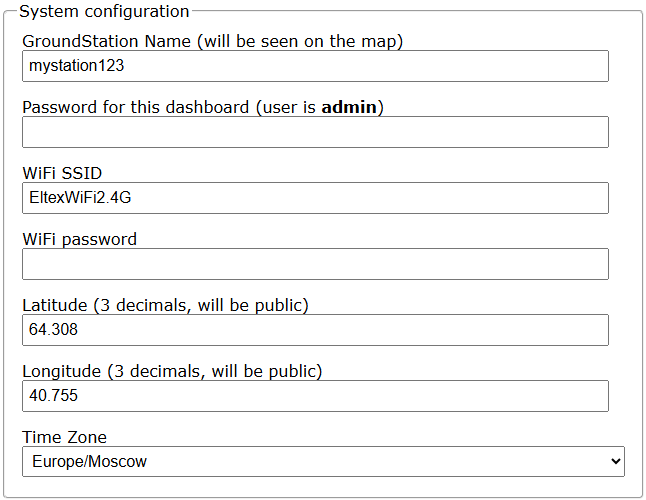  
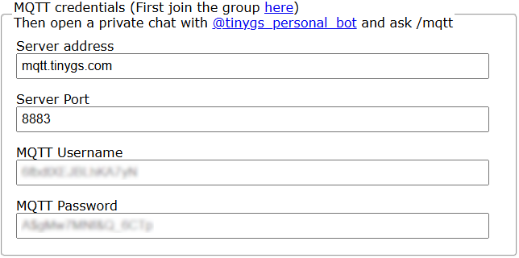

Остальные параметры оставьте без изменения. Нажмите копку `Apply` внизу страницы. Вы снова попадете на начальное **Окно настроек**. 

## Окно конфигурации (Шаг 3)

Снова нажимаем `Configure parameters`.  


В поле **Board Template** (Шаблон устройства) нужно ввести следующую строку:  
```
{"name":"NodeMCU ESP32 Ra-02", "aADDR":0, "oSDA":21, "oSCL":22, "oRST":0, "pBut":0, "led":2, "radio":1, "lNSS":5, "lDIO0":26, "lDIO1":0, "lBUSSY":0, "lRST":14, "lMISO":19, "lMOSI":23, "lSCK":18, "lTCXOV":0.0}
```   

Вид форм, заполненных на данном этапе, должен выглядеть следующим образом.

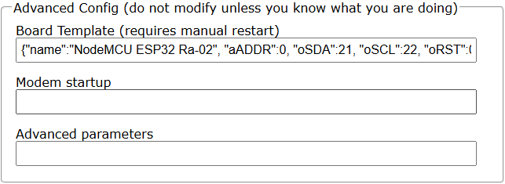  

Остальные параметры оставьте без изменения. Нажмите копку `Apply` внизу страницы. Вы снова попадете на начальное **Окно настроек**. 

## Финальная перезагрузка  

Чтобы все выполненные настройки вступили в силу, требуется перезагрузка приемной станции. В окне настроек нажмите `Restart station`.  

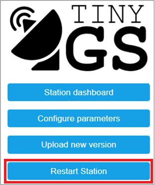  

Через пару секунд станция перезагрузится и будет готова к работе. На экране вы снова увидите **Окно настроек**.  

## Локальная панель управления

Нажмите кнопку `Station Dashboard`.  

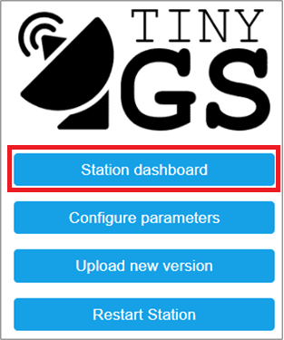  

В появившемся окне вы увидите локальную панель управления приемной станцией. Она доступна только когда приемная станция и компьютер подключены к одной WiFi-сети. В верхней части панели можно видеть текущий статус станции, отслеживаемый в данный момент спутник и последний принятый пакет данных. В нижней части отображается сам процесс наблюдения, а также принятые данные.  

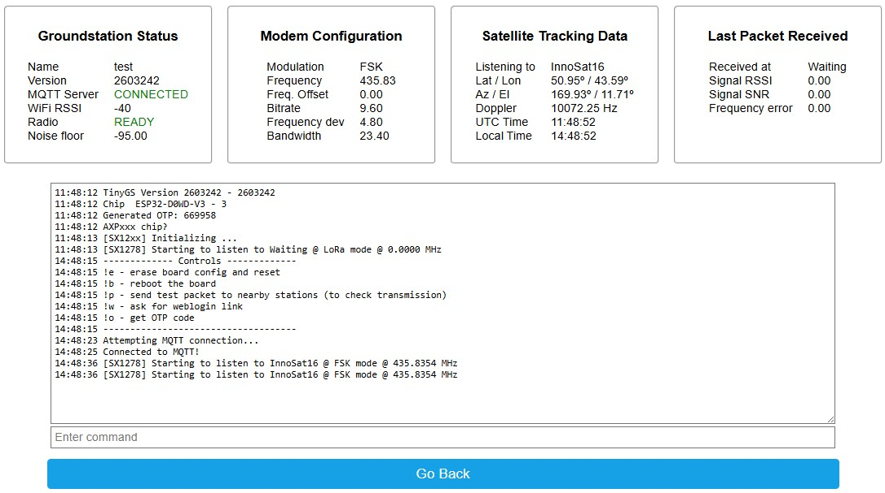 

## Расширенная панель управления

Наблюдать за приемом данных можно через интернет с помощью **Расширенной панели управления**.  

Перейдите к общему списку станций https://app.tinygs.com/stations  
В поле **Find station** впишите имя своей приемной станции. Затем в списке ниже нажмите на её название.  

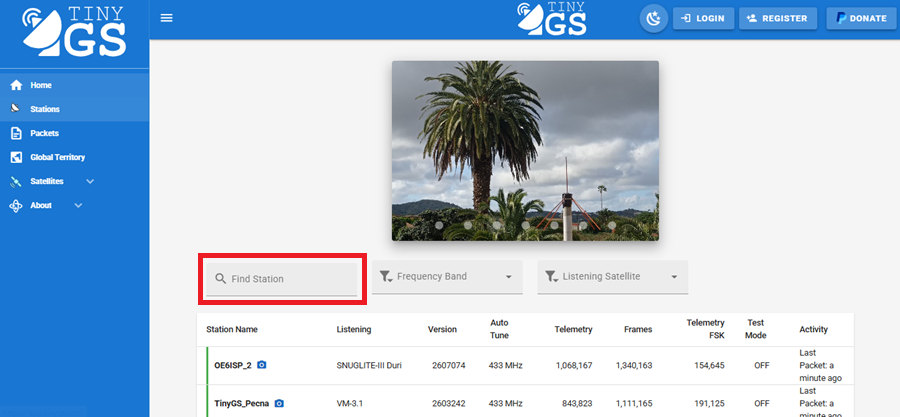 

Вы попадете в **Расширенную панель управления**. В верхней части страницы приведена вся информация о конфигурации станции и её текущем состоянии.  

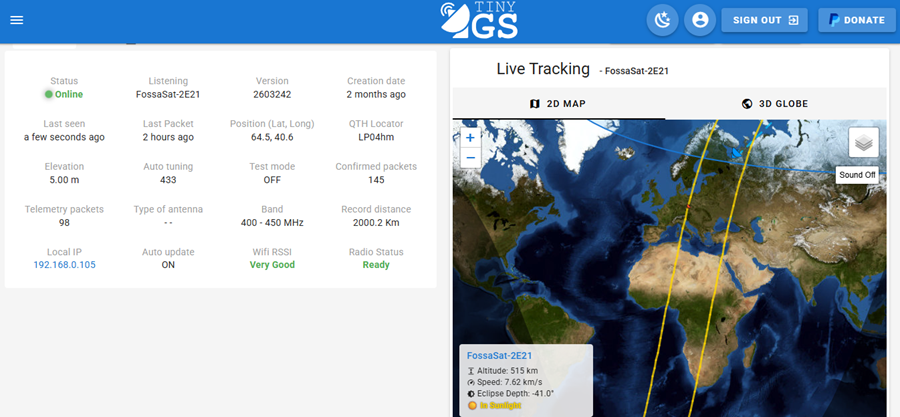  

Ниже представлена информация о планируемых пролетах космических аппаратов.  

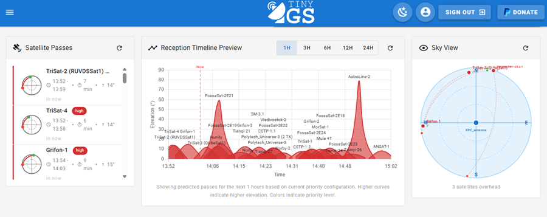  

Далее приведены пакеты данных, принятые с различных спутников за последние 30 дней.  

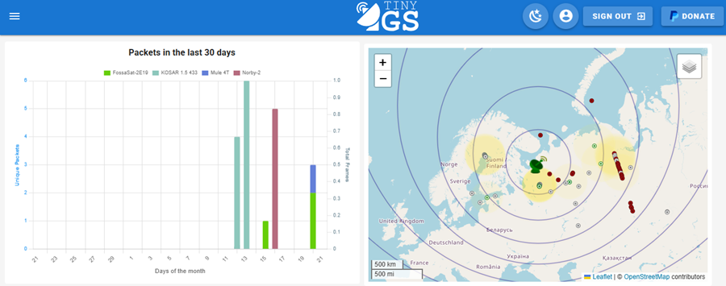  

В самом низу страницы приведен список принятых пакетов. Если нажать один из пакетов, можно получить подробную информацию о принятых данных.  

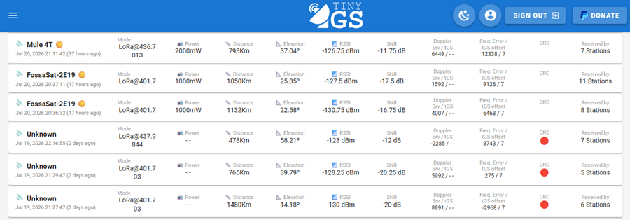  

После нажатия на один из пакетов, мы попадаем на страницу с подробной информацией, где приведены данные в шестнадцатеричной системе счисления (блок **Hexadecimal View**) и эти же данные, декодированные в значения телеметрии спутника (блок **Decoded Telemetry**).

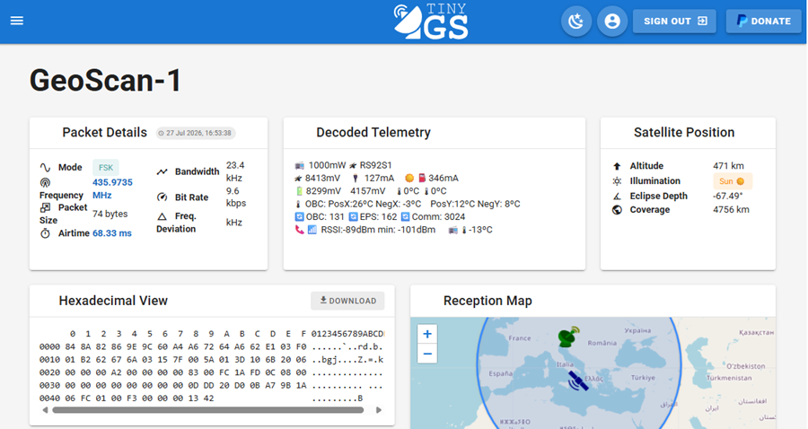  

<details>
  <summary>Ссылка на личный кабинет в Telegram</summary>
  
  Доступ ко всем созданнымим вами станциям можно получить также через **Telegram**. В Telegram-боте нажмите `Menu`, затем нажать `Generates a login link for web`. 

  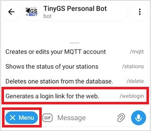  

  В появившемся сообщении – перейти по ссылке. Вы попадете в личный кабинет.  

  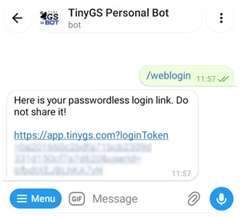  

  Нажмите на название своей приемной станции.  

  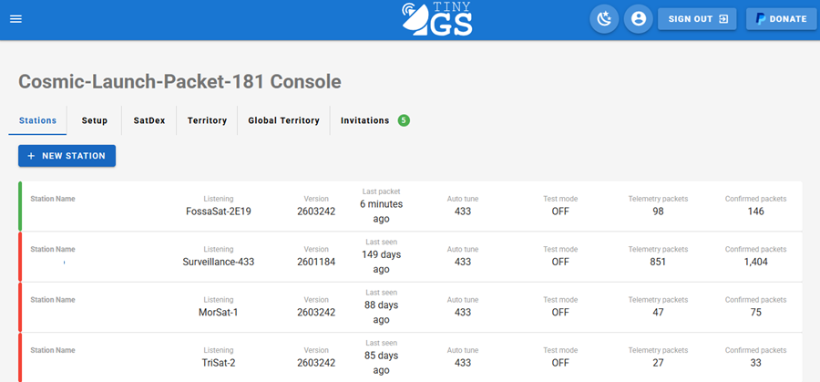  

  В личном кабинете вы можете более тонко настраивать свою станцию.  
</details>

Настройка станции завершена!
Теперь необходимо разместить станцию на окне и ждать приема сигналов со спутников.